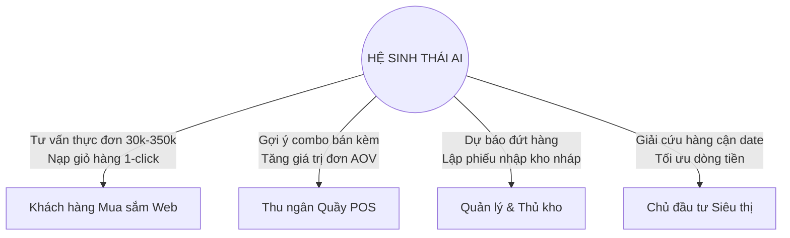

# 10_AI - TÀI LIỆU 00: MỤC TIÊU & PHẠM VI HỆ SINH THÁI AI (AI VISION & SCOPE)

---

## MỤC LỤC
1. [Tầm nhìn chiến lược (Vision)](#1-tầm-nhìn-chiến-lược-vision)
2. [Mục tiêu cốt lõi & Chỉ số đo lường (Strategic Goals & OKRs)](#2-mục-tiêu-cốt-lõi--chỉ-số-đo-lường-strategic-goals--okrs)
3. [Phạm vi triển khai (Scope of Work)](#3-phạm-vi-triển-khai-scope-of-work)
   - 3.1. [Phạm vi thuộc dự án (In-Scope)](#31-phạm-vi-thuộc-dự-án-in-scope)
   - 3.2. [Phạm vi ngoài dự án (Out-of-Scope)](#32-phạm-vi-ngoài-dự-án-out-of-scope)
4. [Đối tượng thụ hưởng & Ma trận giá trị (Value Proposition Matrix)](#4-đối-tượng-thụ-hưởng--ma-trận-giá-trị)
5. [Nguyên tắc định hướng (Guiding Principles)](#5-nguyên-tắc-định-hướng-guiding-principles)

---

## 1. TẦM NHÌN CHIẾN LƯỢC (VISION)

Hệ sinh thái AI trong **Smart SuperMarket** định hình lại trải nghiệm bán lẻ thực phẩm số tại Việt Nam bằng cách kết nối trực tiếp **nghệ thuật ẩm thực gia đình** với **hạ tầng kho vận siêu thị thời gian thực**:

> *"Biến việc đi chợ hàng ngày từ một nghĩa vụ mất thời gian thành một trải nghiệm ẩm thực thông minh, cá nhân hóa, tối ưu ngân sách và triệt tiêu lãng phí thực phẩm."*

Hệ thống kết hợp sức mạnh của Mô hình Ngôn ngữ Lớn (LLMs - Google Gemini 2.5 Flash, Groq LPU Llama 3.3) với cẩm nang công thức nấu ăn chuẩn vị Cookpad Việt Nam và CSDL quản trị hàng hóa theo lô hạn dùng (Shelf-life & Expiry Batches).

---

## 2. MỤC TIÊU CỐT LÕI & CHỈ SỐ ĐO LƯỜNG (STRATEGIC GOALS & OKRS)

| Mục tiêu (Objective) | Kết quả then chốt (Key Results - KRs) | Tác động thực tế |
| :--- | :--- | :--- |
| **1. Giải bài toán "Hôm nay ăn gì?"** | • Phản hồi $\le 1.5\text{s}$ với 3 phương án mâm cơm. • Tỷ lệ chuyển đổi chọn mâm vào giỏ hàng $\ge 35\%$. | Khách hàng không mất thời gian suy nghĩ món ăn và chọn lẻ từng món. |
| **2. Tối ưu hóa ngân sách mọi phân khúc** | • Đáp ứng chính xác từ mâm cơm sinh viên 30k - 50k đến đại tiệc lẩu 350k. • Sai số ngân sách thực tế $\le 10\%$. | Người dùng kiểm soát được chi tiêu đi chợ hàng ngày. |
| **3. Giảm thiểu thất thoát hàng cận date** | • Tự động gắn nhãn Flash Sale giảm 30% cho lô hàng $\le 7$ ngày. • Giảm $25\%$ lượng hàng tươi sống bị hủy bỏ do hết hạn. | Tối ưu biên lợi nhuận siêu thị, bảo vệ môi trường (Zero Food Waste). |
| **4. Tự động hóa vận hành bán lẻ** | • Rút ngắn $70\%$ thời gian lập phiếu nhập kho nháp. • 1-Click lưu trực tiếp đơn nhập hàng vào CSDL. | Ban quản lý và thủ kho ra quyết định mua hàng chính xác dựa trên dữ liệu. |

---

## 3. PHẠM VI TRIỂN KHAI (SCOPE OF WORK)

### 3.1. Phạm vi thuộc dự án (In-Scope)

1. **Khách hàng Mua sắm (Web Client - React Vite)**:
   - Cửa sổ chat thông minh **Chef & Shopping Concierge** (`AiShoppingAssistant.tsx`).
   - Tự động bóc tách số người ăn (`servings`) và ngân sách (`targetBudget`) từ văn bản tự nhiên.
   - Gợi ý 3 mâm cơm chuẩn cẩm nang Cookpad, phân biệt rõ các mức chi tiêu (bình dân, trung cấp, thịnh soạn).
   - Bộ lọc ưu tiên giải cứu thực phẩm Flash Sale cận date.
   - Thẻ mâm cơm căn lề trái hiển thị đơn giá, nút chọn mâm mở modal tùy chỉnh thêm/bớt và nạp 1-click vào giỏ hàng `/cart`.
   - Trả lời các câu hỏi mẹo ẩm thực Cookpad (bí quyết luộc rau muống xanh giòn, ướp thịt bò mềm, khử tanh hải sản...).

2. **Quản lý & Thu mua (Desktop WinForms - .NET 10)**:
   - Giao diện **AI Copilot** cho nhà quản lý (`AiCopilotView.cs`).
   - Phân tích rủi ro kho hàng và hạn sử dụng động (Shelf-life Risk Matrix: Đỏ/Cam/Xanh).
   - Khai phá rổ hàng thị trường (Market Basket Analysis) tìm các combo thường mua cùng nhau từ lịch sử đơn hàng.
   - Tự động tính toán lượng thiếu hụt và lập phiếu nhập kho nháp (`AiDraftImportOrder`).
   - 1-Click Commit phiếu nhập kho vào CSDL (`ImportReceipts`, `ImportDetails`).

3. **Hạ tầng AI Backend (.NET 10 ASP.NET Core)**:
   - Kiến trúc trừu tượng hóa `ILlmClient`.
   - Tích hợp Google Gemini (mặc định `gemini-2.5-flash`, tự động fallback sang `gemini-2.0-flash` / `gemini-1.5-flash`).
   - Tích hợp Groq Cloud LPU (`llama-3.3-70b-versatile`).
   - Bộ quy tắc dự phòng nội bộ (Deterministic Cookpad Rule Engine) đảm bảo hoạt động 100% không phụ thuộc Internet.

### 3.2. Phạm vi ngoài dự án (Out-of-Scope)
- **Tự động thanh toán trừ tiền thẻ**: AI chỉ nạp nguyên liệu vào giỏ hàng; bước thanh toán bắt buộc do người dùng chủ động xác nhận.
- **Robot lấy hàng vật lý**: AI chỉ quản lý dữ liệu số, không điều khiển phần cứng tự động hóa kho bãi.
- **Tư vấn dinh dưỡng y khoa chuyên sâu**: AI không đóng vai trò bác sĩ chẩn đoán bệnh lý, chỉ tư vấn công thức nấu ăn dân gian lành mạnh.

---

## 4. ĐỐI TƯỢNG THỤ HƯỞNG & MA TRẬN GIÁ TRỊ

| Nhóm người dùng | Thách thức hiện tại | Giải pháp từ AI | Lợi ích thu được |
| :--- | :--- | :--- | :--- |
| **Sinh viên & Người bận rộn** | Ngân sách hẹp (30k - 50k), không biết nấu gì nhanh và đủ chất. | Đề xuất mâm trứng chiên canh rau muống, mì xào xúc xích cải ngọt... | Tiết kiệm tiền bạc, có bữa ăn ngon trong 10 phút. |
| **Gia đình nhiều thế hệ** | Khẩu vị phức tạp, cần đổi món thường xuyên. | Gợi ý 3 thực đơn đa dạng: Kho tàu, sườn chua ngọt, gà rim, canh mướp... | Bữa cơm gia đình ấm cúng chuẩn vị Cookpad. |
| **Nhân viên thu mua** | Tính toán tồn kho và đặt hàng thủ công tốn hàng giờ. | Tự động quét ngưỡng `MinStockLevel` và lập đơn nhập kho nháp. | Nhanh chóng, chính xác, không lo cạn hàng. |

---

## 5. NGUYÊN TẮC ĐỊNH HƯỚNG (GUIDING PRINCIPLES)

1. **Grounding trên dữ liệu thật (Truthfulness)**: Mọi nguyên liệu đề xuất phải tồn tại thật trong kho siêu thị với đúng đơn giá niêm yết.
2. **Tôn trọng văn hóa giao tiếp (Respectful Persona)**: Xưng là `"mình"`, gọi khách là `"bạn"`, tuyệt đối không dùng đại từ không trang trọng.
3. **Thiết kế trực quan, căn lề trái (Usability First)**: Toàn bộ bong bóng chat và thẻ card phải căn lề trái tự nhiên, không lặp lại văn bản thừa thãi.
4. **Không gián đoạn vận hành (High Availability)**: Luôn có chuỗi dự phòng 3 lớp đảm bảo hệ thống phản hồi mượt mà trong mọi tình huống.
