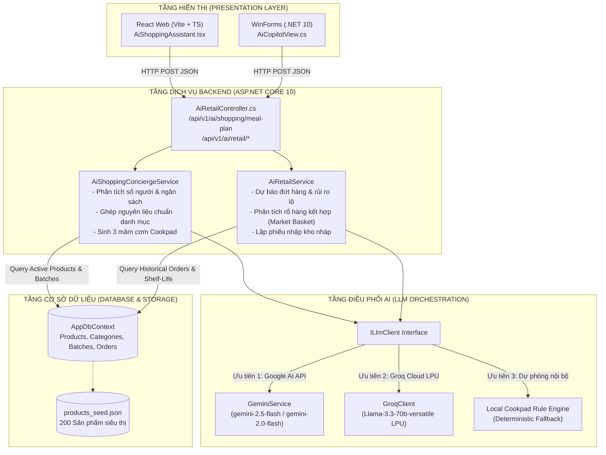

# 10_AI - TÀI LIỆU 01: KIẾN TRÚC TỔNG THỂ HỆ THỐNG AI (AI ARCHITECTURE)

---

## MỤC LỤC
1. [Tổng quan kiến trúc phân tầng](#1-tổng-quan-kiến-trúc-phân-tầng)
2. [Sơ đồ khối hệ thống (System Architecture Diagram)](#2-sơ-đồ-khối-hệ-thống)
3. [Chi tiết các tầng kiến trúc](#3-chi-tiết-các-tầng-kiến-trúc)
4. [Cơ chế điều phối LLM & Fallback Chained Engine](#4-cơ-chế-điều-phối-llm--fallback-chained-engine)
5. [Hiệu năng, Độ trễ (SLA) & Quản lý Token](#5-hiệu-năng-độ-trễ-sla--quản-lý-token)

---

## 1. TỔNG QUAN KIẾN TRÚC PHÂN TẦNG

Hệ sinh thái AI trong **Smart SuperMarket** được xây dựng theo mô hình **Multi-Tier Decoupled Architecture** (Kiến trúc phân tầng tách rời), kết hợp giữa khả năng xử lý ngôn ngữ tự nhiên mạnh mẽ của các Mô hình Ngôn ngữ Lớn (LLMs) trên nền đám mây và tính toán nghiệp vụ CSDL chính xác của Backend ASP.NET Core.

Hệ thống bao gồm 4 tầng chính:
1. **Presentation Layer (Tầng hiển thị)**: Giao diện Chatbot React Web cho khách mua sắm & Form WinForms AI Copilot cho nhà quản lý.
2. **API & Service Layer (Tầng nghiệp vụ AI)**: Bộ điều phối nghiệp vụ ẩm thực, rổ hàng, rủi ro tồn kho và kiểm kê.
3. **LLM Orchestration Layer (Tầng điều phối AI)**: Giao diện trừu tượng `ILlmClient` điều phối kết nối giữa Google Gemini, Groq LPU và Rule-Engine nội bộ.
4. **Data & Persistence Layer (Tầng dữ liệu)**: CSDL quan hệ lưu trữ sản phẩm, lô hàng, hóa đơn và lịch sử giao dịch.

---

## 2. SƠ ĐỒ KHỐI HỆ THỐNG



---

## 3. CHI TIẾT CÁC TẦNG KIẾN TRÚC

### 3.1. Tầng hiển thị (Presentation Layer)
- **Frontend Web Client**: Tích hợp cửa sổ chat thông minh `AiShoppingAssistant.tsx`, hỗ trợ tin nhắn Markdown, bộ lọc ưu tiên Flash Sale, hiển thị danh thiếp 3 mâm cơm chuẩn vị căn lề trái và modal tương tác thêm/bớt định lượng nguyên liệu trước khi nạp vào giỏ hàng `CartPage`.
- **Desktop POS & Admin**: Tích hợp `AiCopilotView.cs` hỗ trợ nhân viên quản lý kho quét nhanh các mặt hàng có nguy cơ hư hỏng và phát sinh đơn nhập hàng tự động.

### 3.2. Tầng dịch vụ nghiệp vụ (AI Service Layer)
- **AiShoppingConciergeService**: Tiếp nhận yêu cầu tự nhiên của khách hàng, trích xuất cấu trúc (`Servings`, `TargetBudget`, `DishTheme`), truy vấn kho hàng thật và xây dựng các phương án mâm cơm dinh dưỡng chuẩn công thức Cookpad.
- **AiRetailService**: Thực hiện thuật toán khai phá tập mục thường xuyên (Frequent Itemset Mining) từ dữ liệu hóa đơn `OrderDetails` để tìm các cặp sản phẩm thường mua kèm nhau, đồng thời tính toán tốc độ tiêu thụ sản phẩm (Run-rate) để cảnh báo thiếu hụt hàng.

### 3.3. Tầng điều phối LLM (LLM Orchestration Layer)
- Được định nghĩa qua giao diện chuẩn `ILlmClient`:
  ```csharp
  public interface ILlmClient
  {
      string ProviderName { get; }
      Task<string> GenerateAsync(string prompt, CancellationToken cancellationToken = default);
      Task<string> GenerateAsync(string prompt, string? systemInstruction = null, bool requireJson = false, CancellationToken cancellationToken = default);
  }
  ```

---

## 4. CƠ CHẾ ĐIỀU PHỐI LLM & FALLBACK CHAINED ENGINE

Để đảm bảo hệ thống không bao giờ gặp lỗi ngưng trệ khi người dùng chat, cơ chế **Fallback Chain** (Chuỗi dự phòng 3 lớp) được triển khai tại `GeminiService.cs`:

1. **Lớp 1 (Primary - Google Gemini)**:
   - Kiểm tra `Gemini:ApiKey` hợp lệ (bắt đầu bằng `AIzaSy`).
   - Gọi trực tiếp mô hình `gemini-2.5-flash`.
   - Nếu gặp mã phản hồi `404 Not Found`, tự động chuyển tiếp sang `gemini-2.0-flash` hoặc `gemini-1.5-flash`.
2. **Lớp 2 (Secondary - Groq LPU Cloud)**:
   - Nếu Gemini trả về lỗi xác thực (400, 401, 403) hoặc vượt ngưỡng hạn mức Rate-Limit, hệ thống chuyển tiếp sang Groq Cloud (`Llama-3.3-70b-versatile`). Tốc độ sinh text trên chip LPU đạt ~250 tokens/giây, đảm bảo thời gian phản hồi dưới 1 giây.
3. **Lớp 3 (Deterministic Safety Net - Local Cookpad Engine)**:
   - Nếu cả 2 nhà cung cấp API bên ngoài đều không khả dụng hoặc mất kết nối mạng internet, hệ thống ngay lập tức kích hoạt bộ sinh nội dung chuyên gia được tích hợp sẵn từ CSDL kho hàng. Người dùng vẫn nhận được 3 lựa chọn mâm cơm đầy đủ giá tiền, danh sách nguyên liệu và bí quyết nấu ăn mà không hề nhận thông báo lỗi.

---

## 5. HIỆU NĂNG, ĐỘ TRỄ (SLA) & QUẢN LÝ TOKEN

| Chỉ số | Mục tiêu SLA | Giải pháp đạt được |
| :--- | :--- | :--- |
| **Thời gian phản hồi (TTFT)** | < 1.5 giây | Tối ưu hóa prompt súc tích; cấu hình `temperature = 0.5 - 0.7` và `maxOutputTokens = 2048`. |
| **Độ chính xác nguyên liệu** | 100% đúng kho hàng | Phân loại CategoryId nghiêm ngặt trước khi đưa vào context gợi ý, loại bỏ hiện tượng ảo giác (Hallucination). |
| **Thời gian duy trì hoạt động (Uptime)**| 99.9% | Nhờ cơ chế Fallback Chained Engine 3 lớp bảo vệ độc lập. |
| **Tiết kiệm Token (Token Budget)** | ~500 - 800 tokens/lượt | Chỉ gửi vào context top 10 - 15 sản phẩm tiêu biểu có liên quan trực tiếp thay vì toàn bộ CSDL. |
