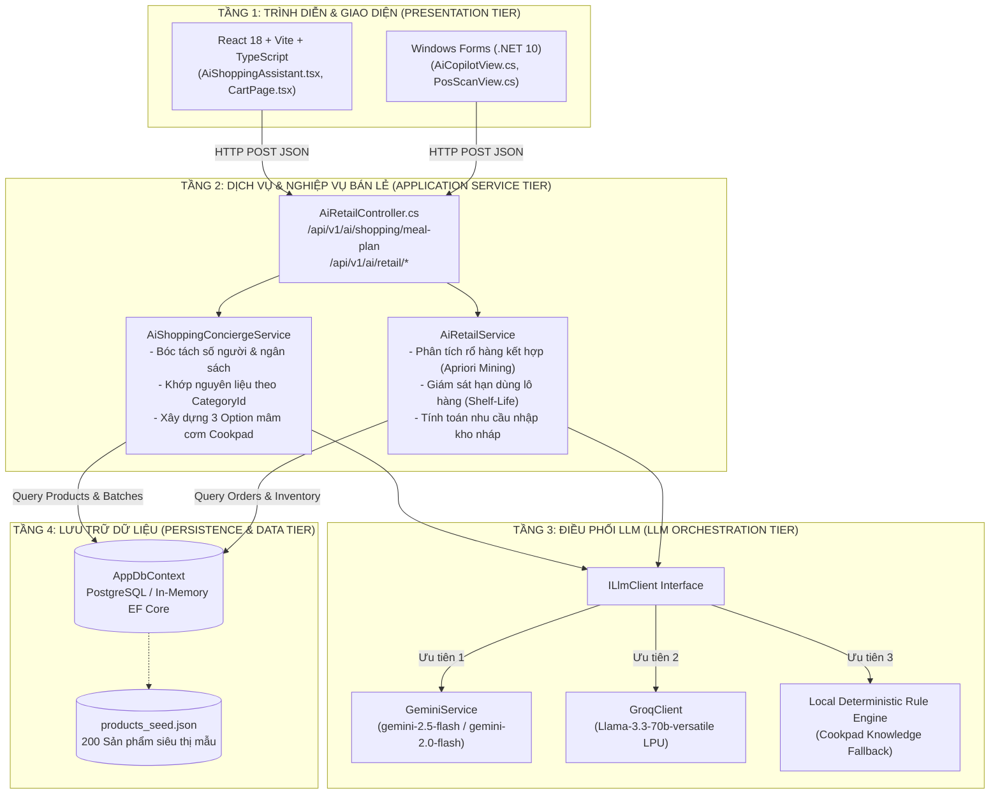
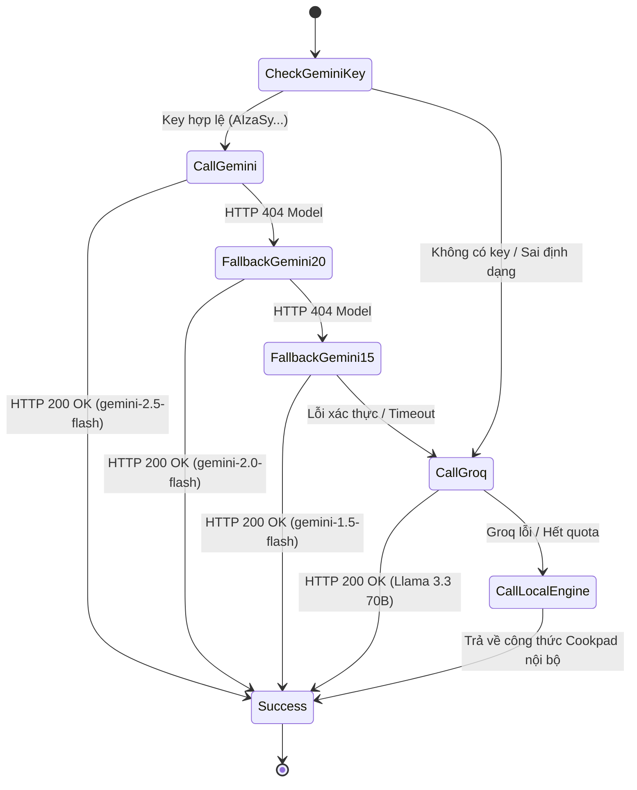

# 10_AI - TÀI LIỆU 01: KIẾN TRÚC TỔNG THỂ HỆ THỐNG AI (AI ARCHITECTURE)

---

## MỤC LỤC
1. [Tổng quan kiến trúc phân tầng (Multi-Tier Architecture)](#1-tổng-quan-kiến-trúc-phân-tầng)
2. [Sơ đồ kiến trúc tổng thể (High-Level Architecture Diagram)](#2-sơ-đồ-kiến-trúc-tổng-thể)
3. [Luồng dữ liệu xuyên suốt hệ thống (End-to-End Data Flow)](#3-luồng-dữ-liệu-xuyên-suốt-hệ-thống)
4. [Cơ chế điều phối LLM & Chuỗi dự phòng 3 lớp (Fallback Chain Engine)](#4-cơ-chế-điều-phối-llm--chuỗi-dự-phòng-3-lớp)
5. [Hiệu năng, Độ trễ (SLA) & Ngân sách Token (Token Budgeting)](#5-hiệu-năng-độ-trễ-sla--ngân-sách-token)

---

## 1. TỔNG QUAN KIẾN TRÚC PHÂN TẦNG

Hệ sinh thái AI trong **Smart SuperMarket** được xây dựng theo mô hình **Phân tầng tách rời (Decoupled Multi-Tier Architecture)**, đảm bảo tính mô-đun hóa, khả năng mở rộng linh hoạt và độc lập giữa giao diện người dùng, nghiệp vụ tính toán và các nhà cung cấp mô hình trí tuệ nhân tạo.



---

## 2. SƠ ĐỒ KIẾN TRÚC TỔNG THỂ

### 2.1. Tầng Trình diễn (Presentation Tier)
- **Web Client (React + TypeScript)**: Thành phần `AiShoppingAssistant.tsx` đóng vai trò là cửa sổ trò chuyện nổi (Floating Chat Widget). Tích hợp Markdown renderer, hỗ trợ phân tách tiêu đề in đậm, danh sách lựa chọn căn lề trái và tương tác nạp giỏ hàng qua `handleOpenMealModal`.
- **Desktop WinForms (.NET 10)**: Màn hình `AiCopilotView.cs` phục vụ cấp Quản lý, hiển thị biểu đồ rủi ro kho, phân tích cặp sản phẩm bán chạy và nút bấm lập đơn nhập kho tự động.

### 2.2. Tầng Ứng dụng & Nghiệp vụ (Application Service Tier)
- Chịu trách nhiệm thực thi toàn bộ logic cốt lõi:
  - Bóc tách tham số tự nhiên: Tìm số người ăn (`servings`) và ngân sách (`targetBudget`) thông qua biểu thức chính quy (Regex).
  - Phân loại chủ đề món ăn (`DetermineDishTheme`): Lẩu, Sườn non, Thịt kho tàu, Bò Úc, Gà rim, Món chay, hoặc Bữa ăn tiết kiệm (< 50k).
  - Ghép sản phẩm cách ly theo danh mục (`MatchProductsForQueries`).

### 2.3. Tầng Điều phối LLM (LLM Orchestration Tier)
- Đóng gói toàn bộ các cuộc gọi AI qua giao diện chuẩn `ILlmClient`:
  ```csharp
  public interface ILlmClient
  {
      string ProviderName { get; }
      Task<string> GenerateAsync(string prompt, CancellationToken cancellationToken = default);
      Task<string> GenerateAsync(string prompt, string? systemInstruction = null, bool requireJson = false, CancellationToken cancellationToken = default);
  }
  ```

---

## 3. LUỒNG DỮ LIỆU XUYÊN SUỐT HỆ THỐNG

1. **Client Request**: Người dùng gửi tin nhắn: `"Mình có 30k 1 người ăn thì nấu món gì"`.
2. **Controller Entrypoint**: `AiRetailController.PlanMealAndShop` tiếp nhận payload.
3. **Intent & Parameter Parsing**: `AiShoppingConciergeService` xác định số người = 1, ngân sách = 30.000 đ, chủ đề = `"Bữa Ăn Tiết Kiệm"`.
4. **Data Retrieval & Matching**: Hệ thống tải danh mục sản phẩm từ CSDL và ghép chính xác:
   - Option 1: Trứng gà Ba Huân vỉ 10 quả (Cat 9) + Rau muống nước (Cat 4) $\rightarrow$ 30.800 đ.
   - Option 2: Mì Omachi sườn hầm (Cat 10) + Xúc xích Vissan (Cat 10) + Cải ngọt (Cat 4) $\rightarrow$ 44.300 đ.
   - Option 3: Cá nục sốt cà Ba Cô Gái (Cat 10) + Dưa leo baby (Cat 4) $\rightarrow$ 28.900 đ.
5. **Prompt Augmentation & LLM Generation**: Tạo prompt tóm tắt gửi sang Gemini 2.5 Flash để sinh lời thoại đầu bếp thân thiện.
6. **Response Delivery**: Trả về `MealPlanChatResponse` gồm lời nhắn Markdown và danh sách 3 `MealOptionDto`.

---

## 4. CƠ CHẾ ĐIỀU PHỐI LLM & CHUỖI DỰ PHÒNG 3 LỚP (FALLBACK CHAIN)

Hệ thống triển khai cơ chế **Fallback Chain** tự động tại [GeminiService.cs](file:///D:/Laptrinhtrucquan/Backend/Infrastructure/External/AI/GeminiService.cs) để đảm bảo không bao giờ gián đoạn dịch vụ:



1. **Lớp 1 (Google Gemini 2.5 Flash)**:
   - Ưu tiên gọi mô hình `gemini-2.5-flash`.
   - Nếu trả về `404 Not Found`, tự động chuyển sang `gemini-2.0-flash` hoặc `gemini-1.5-flash`.
2. **Lớp 2 (Groq Cloud LPU - Llama 3.3 70B)**:
   - Kích hoạt khi Gemini gặp sự cố mạng, lỗi 400/401 hoặc hết hạn ngạch.
   - Xử lý trên chip LPU tốc độ cao (~250 tokens/giây), độ trễ phản hồi < 1 giây.
3. **Lớp 3 (Deterministic Cookpad Safety Net)**:
   - Nếu cả 2 API đám mây đều không khả dụng, hệ thống kích hoạt hàm sinh lời thoại chuyên gia nội bộ `GenerateChefMealMessageWithMultiOptions`. Người dùng vẫn nhận được 3 lựa chọn mâm cơm đầy đủ và chính xác 100%.

---

## 5. HIỆU NĂNG, ĐỘ TRỄ (SLA) & NGÂN SÁCH TOKEN

| Tham số kỹ thuật | Ngưỡng cam kết (SLA) | Cơ chế tối ưu |
| :--- | :---: | :--- |
| **Thời gian phản hồi (Latency)** | $\le 1.5\text{s}$ | Sử dụng streaming / flash models; Groq LPU hỗ trợ fallback siêu tốc. |
| **Ngân sách Token (Token Budget)** | $500 - 800\text{ tokens}$ | Chỉ nạp top 12 sản phẩm liên quan vào context, không nhồi nhét toàn bộ kho hàng. |
| **Tỷ lệ sẵn sàng (Availability)** | $99.9\%$ | Chuỗi dự phòng 3 lớp đảm bảo luôn có kết quả trả về. |
| **Độ chính xác danh mục** | $100\%$ | Sử dụng `IngredientQuery` cách ly CategoryId, triệt tiêu ảo giác sai sản phẩm. |
