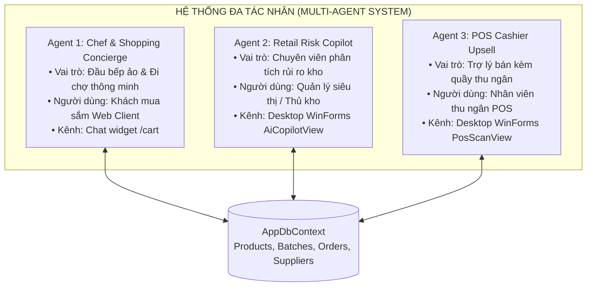
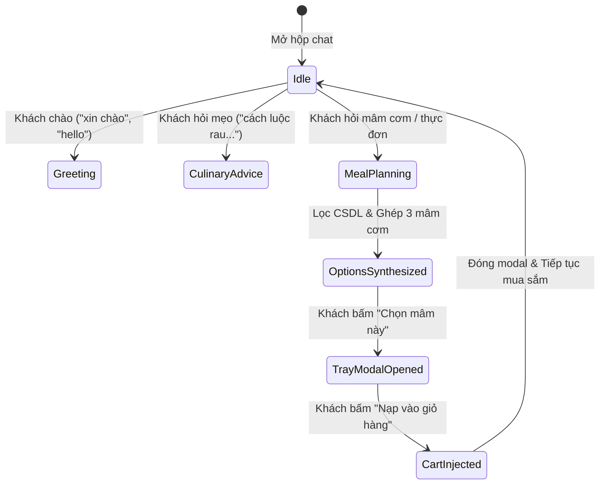

# 10_AI - TÀI LIỆU 02: THIẾT KẾ ĐA TÁC NHÂN CHUYÊN BIỆT (MULTI-AGENT DESIGN)

---

## MỤC LỤC
1. [Mô hình thiết kế Đa tác nhân (Multi-Agent Architecture Pattern)](#1-mô-hình-thiết-kế-đa-tác-nhân)
2. [Tác nhân 1: Chef & Shopping Concierge Agent (Đầu bếp & Đi chợ)](#2-tác-nhân-1-chef--shopping-concierge-agent)
3. [Tác nhân 2: Retail Operations & Inventory Risk Copilot Agent (Quản trị kho bán lẻ)](#3-tác-nhân-2-retail-operations--inventory-risk-copilot-agent)
4. [Tác nhân 3: POS Cashier Smart Upsell Agent (Trợ lý quầy thu ngân)](#4-tác-nhân-3-pos-cashier-smart-upsell-agent)
5. [Cơ chế phối hợp & Quản lý bộ nhớ ngữ cảnh (Agent Memory & Context)](#5-cơ-chế-phối-hợp--quản-lý-bộ-nhớ-ngữ-cảnh)

---

## 1. MÔ HÌNH THIẾT KẾ ĐA TÁC NHÂN

Thay vì sử dụng một mô hình duy nhất xử lý chung tất cả yêu cầu, **Smart SuperMarket** phân rã nghiệp vụ thành 3 Tác nhân chuyên biệt hóa (Specialized AI Agents). Mỗi tác nhân có Persona, phạm vi dữ liệu và tập công cụ nghiệp vụ riêng:



---

## 2. TÁC NHÂN 1: CHEF & SHOPPING CONCIERGE AGENT

### 2.1. Mục tiêu & Nhiệm vụ cốt lõi
- **Mục tiêu**: Lắng nghe nhu cầu bữa ăn của khách hàng và biến chúng thành **3 phương án mâm cơm** chuẩn vị Cookpad với chi phí tối ưu nhất.
- **Nhiệm vụ chính**:
  1. Trích xuất tự động `servings` và `targetBudget` từ văn bản tự nhiên.
  2. Xác định chủ đề món ăn (`DetermineDishTheme`) và lọc đúng sản phẩm từ kho theo `CategoryId`.
  3. Tích hợp thực phẩm cận date giảm giá 30% Flash Sale để tiết kiệm tiền cho khách.
  4. Hướng dẫn bí quyết sơ chế và chế biến chuẩn đầu bếp.

### 2.2. Hồ sơ Persona & Luật giao tiếp
- **Danh xưng bắt buộc**: Xưng là **`"mình"`** và gọi khách là **`"bạn"`**. Tuyệt đối cấm xưng `"em"`, `"tôi"`, `"chúng tôi"`, `"bot"`.
- **Thái độ**: Thân thiện, chu đáo, am hiểu sâu sắc văn hóa ẩm thực gia đình Việt Nam.
- **Định dạng câu trả lời**:
  - Không lặp lại danh sách gạch đầu dòng chi tiết từng nguyên liệu trong text vì các thẻ mâm cơm bên dưới đã hiển thị.
  - Căn lề trái toàn bộ (`text-align: left`).

---

## 3. TÁC NHÂN 2: RETAIL OPERATIONS & INVENTORY RISK COPILOT AGENT

### 3.1. Mục tiêu & Nhiệm vụ cốt lõi
- **Mục tiêu**: Hỗ trợ Quản lý siêu thị và Thủ kho giám sát thời hạn sử dụng của hàng hóa và tự động hóa quy trình nhập hàng.
- **Nhiệm vụ chính**:
  1. **Giám sát Shelf-Life**: Quét các lô hàng trong `InventoryBatches`, phân loại ma trận rủi ro:
     - 🔴 **Đỏ (Rất nguy hiểm)**: Hạn dùng $< 7$ ngày $\rightarrow$ Kích hoạt Flash Sale 30% - 50%.
     - 🟠 **Cam (Cảnh báo)**: Hạn dùng $< 14$ ngày $\rightarrow$ Đưa vào thực đơn ưu tiên đề xuất.
     - 🟢 **Xanh (An toàn)**: Hạn dùng đảm bảo.
  2. **Khai phá rổ hàng thị trường (Market Basket Analysis)**: Tìm các cặp sản phẩm thường mua kèm nhau từ lịch sử `OrderDetails` (ví dụ: Thịt ba chỉ + Trứng vịt).
  3. **Tự động lập đơn nhập kho nháp (`AiDraftImportOrder`)**: Tính toán số lượng cần bù kho dựa trên tồn hiện tại và ngưỡng an toàn `MinStockLevel`.

### 3.2. Hồ sơ Persona
- **Phong cách**: Chuyên nghiệp, logic, súc tích, định hướng hành động dựa trên số liệu CSDL thực tế.

---

## 4. TÁC NHÂN 3: POS CASHIER SMART UPSELL AGENT

### 4.1. Mục tiêu & Nhiệm vụ cốt lõi
- **Mục tiêu**: Giúp nhân viên thu ngân tại quầy gia tăng giá trị trung bình trên mỗi hóa đơn (Average Order Value - AOV).
- **Nhiệm vụ chính**:
  1. Lắng nghe luồng quét mã vạch Barcode tại [PosScanView.cs](file:///D:/Laptrinhtrucquan/Desktop/Views/PosScanView.cs).
  2. Khi quét sản phẩm chính, Agent truy vấn nhanh các mặt hàng bán kèm có độ tương quan cao (ví dụ: quét *"Thịt bò Úc"* $\rightarrow$ gợi ý ngay *"Nấm kim châm"* hoặc *"Gói sốt ướp Barona"*).
  3. Hiển thị thông báo gợi ý nhỏ gọn góc màn hình để thu ngân tư vấn khách hàng.

---

## 5. CƠ CHẾ PHỐI HỢP & QUẢN LÝ BỘ NHỚ NGỮ CẢNH (MEMORY & CONTEXT)

### 5.1. Bộ nhớ trượt (Sliding Window Memory)
- Phía Client gửi kèm mảng `conversationHistory` gồm tối đa 6 lượt tin nhắn gần nhất.
- Backend duyệt ngược lịch sử (`Reverse()`) để truy vết các thông tin ngữ cảnh đã thống nhất ở lượt trước (như số người ăn, mức ngân sách, món yêu thích), giúp người dùng không cần lặp lại thông tin:
  ```csharp
  // Trích xuất số người từ lượt chat trước nếu lượt này không nhắc lại
  foreach (var msg in history.AsEnumerable().Reverse())
  {
      var hMatch = Regex.Match(msg.Content, @"(\d+)\s*(người|suất|phần)", RegexOptions.IgnoreCase);
      if (hMatch.Success && int.TryParse(hMatch.Groups[1].Value, out int count)) return count;
  }
  ```

### 5.2. Máy trạng thái Agent (Agent State Machine)


