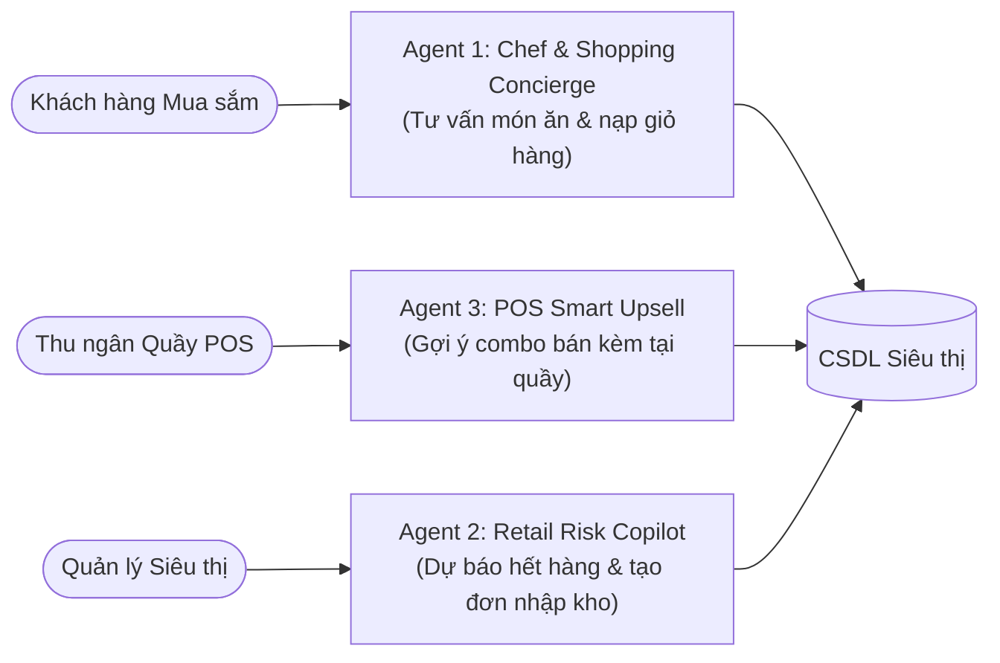
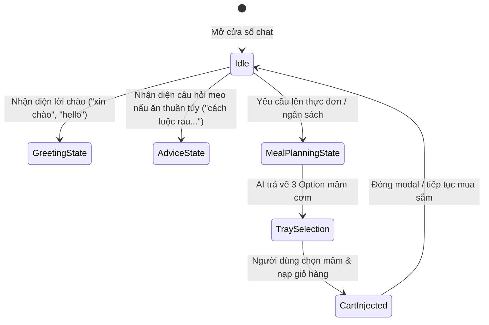

# 10_AI - TÀI LIỆU 02: THIẾT KẾ CÁC TÁC NHÂN THÔNG MINH (AGENT DESIGN)

---

## MỤC LỤC
1. [Triết lý thiết kế Đa tác nhân (Multi-Agent Design Pattern)](#1-triết-lý-thiết-kế-đa-tác-nhân)
2. [Tác nhân 1: Chef & Shopping Concierge Agent (Đầu bếp & Đi chợ)](#2-tác-nhân-1-chef--shopping-concierge-agent)
3. [Tác nhân 2: Retail Operations & Inventory Risk Copilot Agent (Quản trị kho bán lẻ)](#3-tác-nhân-2-retail-operations--inventory-risk-copilot-agent)
4. [Tác nhân 3: POS Cashier Smart Upsell Agent (Trợ lý quầy thu ngân)](#4-tác-nhân-3-pos-cashier-smart-upsell-agent)
5. [Quản lý trạng thái & Ngữ cảnh hội thoại (Context & Memory)](#5-quản-lý-trạng-thái--ngữ-cảnh-hội-thoại)

---

## 1. TRIẾT LÝ THIẾT KẾ ĐA TÁC NHÂN

Thay vì sử dụng một mô hình LLM đơn lẻ cho mọi tác vụ, hệ thống **Smart SuperMarket** phân chia trách nhiệm thành các **Tác nhân chuyên biệt hóa (Specialized AI Agents)**. Mỗi tác nhân được trang bị:
- **Vai trò & Persona riêng biệt**: Văn phong, đại từ xưng hô và chuẩn mực giao tiếp được quy chuẩn hóa.
- **Phạm vi dữ liệu (Data Scope)**: Chỉ truy cập vào tập CSDL và bảng nghiệp vụ liên quan, hạn chế tối đa rủi ro bảo mật và tối ưu chi phí Token.
- **Bộ công cụ (Tools/Functions)**: Các hàm C# thực thi tính toán và xử lý đơn hàng cụ thể.

---

## 2. TÁC NHÂN 1: CHEF & SHOPPING CONCIERGE AGENT

### 2.1. Mục tiêu & Trách nhiệm
- **Mục tiêu**: Lắng nghe nhu cầu bữa ăn của khách hàng (ngân sách, số người ăn, sở thích cá nhân, khẩu vị gia đình) và chuyển đổi thành **3 phương án mâm cơm** tối ưu.
- **Trách nhiệm**:
  1. Trích xuất tự động số người ăn (`servings`) và ngân sách (`targetBudget`) từ câu nói tự nhiên.
  2. Tra cứu cẩm nang ẩm thực hàng ngày Cookpad Việt Nam để đảm bảo công thức chuẩn vị, hài hòa ngũ vị và cân bằng dinh dưỡng.
  3. Lọc chính xác các sản phẩm còn tồn kho và có hạn sử dụng an toàn.
  4. Cung cấp mẹo chế biến cụ thể cho từng món ăn.

### 2.2. Hồ sơ tính cách (Persona Profile)
- **Danh xưng**: Tự xưng là `"mình"` và gọi khách hàng là `"bạn"`. Tuyệt đối không dùng đại từ không trang trọng hoặc xưng `"em"`.
- **Thái độ**: Thân thiện, chu đáo, am hiểu sâu sắc về văn hóa ẩm thực gia đình Việt.
- **Định dạng đầu ra**: Tóm tắt 3 phương án rõ ràng, căn lề trái toàn bộ, không lặp lại danh sách chi tiết các mặt hàng vì đã có các thẻ trực quan bên dưới hỗ trợ.

---

## 3. TÁC NHÂN 2: RETAIL OPERATIONS & INVENTORY RISK COPILOT AGENT

### 3.1. Mục tiêu & Trách nhiệm
- **Mục tiêu**: Giúp quản lý siêu thị và thủ kho nắm bắt tình trạng sức khỏe của kho hàng trong vòng vài giây, ngăn chặn triệt để nguy cơ đứt gãy nguồn cung hoặc hư hỏng thực phẩm cận date.
- **Trách nhiệm**:
  1. **Quét dữ liệu Shelf-life**: Tính toán số ngày còn lại của từng lô hàng `InventoryBatches`, phân loại mức độ rủi ro (Đỏ: `< 7 ngày`, Cam: `< 14 ngày`, Xanh: An toàn).
  2. **Phân tích rổ hàng kết hợp (Market Basket Analysis)**: Tìm các cặp sản phẩm thường được mua chung với độ tin cậy (Confidence) và độ nâng (Lift) cao từ các hóa đơn quá khứ.
  3. **Tự động lập đơn nhập hàng nháp (Draft Purchase Order)**: Tính toán số lượng cần nhập bù dựa trên lượng bán trung bình hàng ngày và thời gian giao hàng (`LeadTime`) của nhà cung cấp.

### 3.2. Hồ sơ tính cách
- **Danh xưng**: Báo cáo chuyên nghiệp, logic, ngắn gọn, thiên về số liệu và hành động đề xuất cụ thể.
- **Định dạng**: Bảng số liệu, mã cảnh báo màu sắc và hỗ trợ thao tác lưu phiếu nhập CSDL chỉ với 1 click chuột (`CommitDraftImportOrder`).

---

## 4. TÁC NHÂN 3: POS CASHIER SMART UPSELL AGENT

### 4.1. Mục tiêu & Trách nhiệm
- **Mục tiêu**: Hỗ trợ nhân viên thu ngân tại màn hình POS WinForms tăng giá trị trung bình trên mỗi hóa đơn (AOV - Average Order Value).
- **Trách nhiệm**:
  1. Lắng nghe sự kiện quét mã vạch Barcode sản phẩm tại `PosScanView.cs`.
  2. Dựa trên sản phẩm vừa quét, truy vấn nhanh danh mục bán kèm có độ tương quan cao (ví dụ: quét *"Thịt bò Úc"* sẽ gợi ý *"Nấm kim châm"* hoặc *"Sốt ướp Barona"*).
  3. Hiển thị thông báo nhỏ gọn trên màn hình để thu ngân tư vấn khách hàng ngay tại quầy.

---

## 5. QUẢN LÝ TRẠNG THÁI & NGỮ CẢNH HỘI THOẠI (CONTEXT & MEMORY)

Để các tác nhân có thể ghi nhớ ngữ cảnh qua nhiều lượt trò chuyện liên tiếp (Multi-turn Conversation), kiến trúc áp dụng cơ chế quản lý trạng thái động:

1. **Sliding Window Memory**:
   - Client gửi kèm mảng `conversationHistory` gồm 6 lượt tin nhắn gần nhất (`role: "user" | "assistant"`).
   - Hệ thống tự động truy vết lại các thông tin đã trao đổi ở lượt trước (ví dụ: lượt trước khách đã báo *"nhà có 4 người"*, lượt sau chỉ cần nhắn *"hôm nay muốn ăn lẩu"* thì Agent vẫn nhớ để tính định lượng cho 4 người).
2. **State Transition Diagram**:

