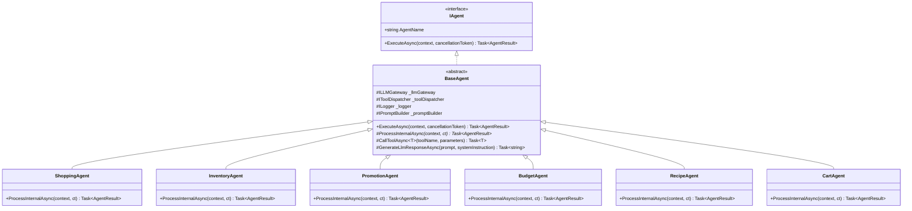

# 10_AI - TÀI LIỆU 02: THIẾT KẾ ĐA TÁC NHÂN & BASE AGENT PATTERN (AGENT DESIGN)

---

## MỤC LỤC
1. [Mô hình kế thừa BaseAgent (BaseAgent Architecture Pattern)](#1-mô-hình-kế-thừa-baseagent)
2. [Chi tiết lớp cơ sở BaseAgent](#2-chi-tiết-lớp-cơ-sở-baseagent)
3. [Tương tác giữa Agent và LLM Gateway (ILLMGateway)](#3-tương-tác-giữa-agent-và-llm-gateway)
4. [Tương tác giữa Agent và Tool Dispatcher](#4-tương-tác-giữa-agent-và-tool-dispatcher)
5. [Đặc tả các Agent chuyên trách (Specialized Agents)](#5-đặc-tả-các-agent-chuyên-trách)
   - [5.1. ShoppingAgent (Planning & Synthesis)](#51-shoppingagent)
   - [5.2. InventoryAgent (Stock, Batches & Expiry)](#52-inventoryagent)
   - [5.3. PromotionAgent (Voucher & Flash Sale)](#53-promotionagent)
   - [5.4. BudgetAgent (Rebalancing & Cheaper Substitutes)](#54-budgetagent)
   - [5.5. RecipeAgent (Cookpad Tra Cứu)](#55-recipeagent)
   - [5.6. CartAgent (Thao Tác Giỏ Hàng)](#56-cartagent)
6. [Lộ trình phát triển MVP $\rightarrow$ Enterprise](#6-lộ-trình-phát-triển-mvp--enterprise)

---

## 1. MÔ HÌNH KẾ THỪA BASEAGENT (BASEAGENT ARCHITECTURE PATTERN)

Thay vì viết lại toàn bộ logic xử lý logging, nạp prompt, bẫy lỗi và điều phối gọi tool cho từng Agent, hệ thống áp dụng mẫu thiết kế **Template Method & Inheritance**:



---

## 2. CHI TIẾT LỚP CƠ SỞ BASEAGENT

Lớp `BaseAgent` đảm nhiệm việc dùng chung (Cross-Cutting Concerns):
1. **Logging & Tracing**: Tự động ghi lại thời gian thực thi, Intent đầu vào và trạng thái thành công/thất bại của từng Agent.
2. **Memory & Context Loading**: Nạp lịch sử hội thoại gần nhất từ `ConversationService`.
3. **Prompt Dynamic Assembly**: Gọi `PromptBuilder` để nạp đúng Identity, Rules và Few-shot Examples tương ứng với từng tác nhân.
4. **Structured Output Parsing**: Parse kết quả trả về từ LLM sang DTO dạng typed sạch sẽ, tự động xử lý khi JSON bị lỗi cú pháp.

```csharp
namespace SmartSupermarket.Backend.Features.AI.Agents.Common;

public abstract class BaseAgent : IAgent
{
    protected readonly ILLMGateway _llmGateway;
    protected readonly IToolDispatcher _toolDispatcher;
    protected readonly ILogger _logger;

    public abstract string AgentName { get; }

    protected BaseAgent(ILLMGateway llmGateway, IToolDispatcher toolDispatcher, ILogger logger)
    {
        _llmGateway = llmGateway;
        _toolDispatcher = toolDispatcher;
        _logger = logger;
    }

    public async Task<AgentResult> ExecuteAsync(AgentContext context, CancellationToken ct = default)
    {
        _logger.LogInformation("[{Agent}] Bắt đầu xử lý intent: {Intent}", AgentName, context.Intent);
        var stopwatch = Stopwatch.StartNew();

        try
        {
            var result = await ProcessInternalAsync(context, ct);
            stopwatch.Stop();
            _logger.LogInformation("[{Agent}] Hoàn thành trong {ElapsedMs}ms", AgentName, stopwatch.ElapsedMilliseconds);
            return result;
        }
        catch (Exception ex)
        {
            _logger.LogError(ex, "[{Agent}] Xảy ra lỗi khi xử lý", AgentName);
            return AgentResult.Failed(AgentName, ex.Message);
        }
    }

    protected abstract Task<AgentResult> ProcessInternalAsync(AgentContext context, CancellationToken ct);

    protected async Task<TResult> CallToolAsync<TResult>(string toolName, Dictionary<string, object> parameters)
    {
        return await _toolDispatcher.DispatchAsync<TResult>(toolName, parameters);
    }
}
```

---

## 3. TƯƠNG TÁC GIỮA AGENT VÀ LLM GATEWAY (ILLMGATEWAY)

- Agent **hoàn toàn không quan tâm** model đang chạy là Gemini 2.5 Flash, Groq Llama 3.3 hay GPT-4o Mini.
- Mọi tương tác diễn ra qua `ILLMGateway.GenerateAsync()`:
```csharp
public interface ILLMGateway
{
    string ActiveProvider { get; }
    Task<string> GenerateTextAsync(string prompt, string systemInstruction, CancellationToken ct = default);
    Task<T> GenerateJsonAsync<T>(string prompt, string systemInstruction, CancellationToken ct = default);
}
```

---

## 4. TƯƠNG TÁC GIỮA AGENT VÀ TOOL DISPATCHER

Agent **không gọi Tool trực tiếp**, mà gửi thông điệp thông qua `_toolDispatcher`:
```csharp
// Trong ShoppingAgent:
var stock = await CallToolAsync<StockResult>("InventoryTool.GetStock", new() { ["productId"] = 105 });
```
Tool Dispatcher sẽ đứng ở giữa để ghi log, đo latency, retry khi CSDL bận, và đảm bảo timeout không vượt quá 1500ms.

---

## 5. ĐẶC TẢ CÁC AGENT CHUYÊN TRÁCH

| Agent | Bounded Context (Chỉ được làm) | Nghiêm Cấm (Không được làm) |
|---|---|---|
| **ShoppingAgent** | Nhận diện nhu cầu, lập kế hoạch, gọi Tool, tổng hợp câu trả lời | Không tự bịa công thức, không tự giảm giá |
| **InventoryAgent** | Kiểm tra tồn, kiểm tra batch, phát hiện cận date, tìm sản phẩm thay thế | **Không tính tiền, không tìm Recipe** |
| **PromotionAgent** | Tra cứu voucher hợp lệ, kiểm tra điều kiện Flash Sale cận date | **Không tự tạo mã voucher ngoài CSDL** |
| **BudgetAgent** | Tính tổng hóa đơn, so sánh ngân sách, đề xuất đổi sang món rẻ hơn | **Không truy cập DB trực tiếp, không đổi món tùy tiện** |
| **RecipeAgent** | Tra cứu cẩm nang Cookpad, bóc tách nguyên liệu chuẩn định lượng | **Không sáng tác công thức ảo không có nguyên liệu tại siêu thị** |
| **CartAgent** | Thêm, xóa, cập nhật giỏ hàng theo 1-Click | Không tự ý thanh toán khi chưa có lệnh |

---

## 6. LỘ TRÌNH PHÁT TRIỂN MVP $\rightarrow$ ENTERPRISE
1. **MVP**: Chỉ triển khai `ShoppingAgent` (kế thừa `BaseAgent`), sử dụng `ToolDispatcher` gọi 4 Tools cơ bản (`ProductTool`, `InventoryTool`, `PromotionTool`, `CartTool`).
2. **Enterprise**: Kích hoạt đầy đủ cả 6 Sub-Agents, thêm RAG Vector Search cho `RecipeAgent`.
