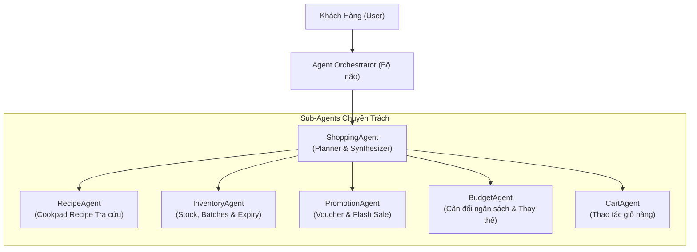

# 10_AI - TÀI LIỆU 02: THIẾT KẾ HỆ THỐNG ĐA TÁC NHÂN (MULTI-AGENT DESIGN)

---

## MỤC LỤC
1. [Triết lý thiết kế Bounded Context trong Multi-Agent](#1-triết-lý-thiết-kế-bounded-context-trong-multi-agent)
2. [Agent Orchestrator: Nhạc trưởng điều phối](#2-agent-orchestrator-nhạc-trưởng-điều-phối)
3. [Chi tiết các Agent chuyên trách (Specialized Agents)](#3-chi-tiết-các-agent-chuyên-trách)
   - [3.1. ShoppingAgent (Kế hoạch & Tổng hợp)](#31-shoppingagent-kế-hoạch--tổng-hợp)
   - [3.2. InventoryAgent (Quản trị Tồn kho & Cận Date)](#32-inventoryagent-quản-trị-tồn-kho--cận-date)
   - [3.3. PromotionAgent (Khuyến mãi & Flash Sale)](#33-promotionagent-khuyến-mãi--flash-sale)
   - [3.4. BudgetAgent (Ngân sách & Thay thế tiết kiệm)](#34-budgetagent-ngân-sách--thay-thế-tiết-kiệm)
   - [3.5. RecipeAgent (Công thức ẩm thực Cookpad)](#35-recipeagent-công-thức-ẩm-thực-cookpad)
   - [3.6. CartAgent (Quản lý giỏ hàng)](#36-cartagent-quản-lý-giỏ-hàng)
4. [Mô hình MVP tối giản vs Enterprise Full Multi-Agent](#4-mô-hình-mvp-tối-giản-vs-enterprise-full-multi-agent)
5. [Cơ chế phối hợp & Quản lý Context hội thoại](#5-cơ-chế-phối-hợp--quản-lý-context-hội-thoại)

---

## 1. TRIẾT LÝ THIẾT KẾ BOUNDED CONTEXT TRONG MULTI-AGENT

Một trong những sai lầm phổ biến khi thiết kế AI cho thương mại điện tử là bắt một Agent duy nhất làm tất cả mọi việc (vừa tra cứu công thức, vừa tính tiền, vừa kiểm tra tồn kho, vừa quyết định giảm giá). Khi đó prompt trở nên quá tải, dễ dẫn đến hiện tượng ảo giác (*Hallucination*), tính sai ngân sách hoặc bịa đặt sản phẩm không có thật trong kho.

**Quy tắc bất biến tại Smart SuperMarket**:
- Mỗi Agent chỉ giải quyết một bài toán duy nhất trong **Bounded Context** của mình.
- Agent **không trực tiếp gọi Service hay Database**, mà phải gọi thông qua **Tool Layer**.
- AI chỉ được phép đưa ra khuyến nghị dựa trên dữ liệu thật từ hệ thống siêu thị.

---

## 2. AGENT ORCHESTRATOR: NHẠC TRƯỞNG ĐIỀU PHỐI

- **Vai trò**: Điểm tiếp nhận duy nhất từ `AIController`.
- **Chức năng**:
  1. Phân tích Intent của User: `MealPlanning`, `ProductSearch`, `PromotionInquiry`, `CartAction`, `GeneralAdvice`.
  2. Xác định chuỗi Agent cần thực thi (Pipeline Execution).
  3. Quản lý trạng thái phiên làm việc (Session Memory & Context History).
  4. Đóng gói kết quả cuối cùng thành `ChatResponseDTO`.

---

## 3. CHI TIẾT CÁC AGENT CHUYÊN TRÁCH

### 3.1. ShoppingAgent (Kế hoạch & Tổng hợp)
- **Nhiệm vụ**:
  - Không làm mọi thứ một mình.
  - Phân tích yêu cầu khách hàng $\rightarrow$ Lập kế hoạch $\rightarrow$ Gọi các Sub-Agent & Tool tương ứng $\rightarrow$ Tổng hợp thành câu trả lời ấm áp và các thẻ mâm cơm.
- **Ví dụ**:
  - Khách: `"Tôi muốn ăn bò 4 người, ngân sách 200k"`.
  - ShoppingAgent: Cần công thức món bò $\rightarrow$ Gọi RecipeAgent; Cần tồn kho $\rightarrow$ Gọi InventoryAgent; Cần khuyến mãi $\rightarrow$ Gọi PromotionAgent; Cần kiểm tra tổng chi $\rightarrow$ Gọi BudgetAgent $\rightarrow$ Xuất bản phản hồi.
- **Quy tắc xưng hô**: Tự xưng là `"mình"`, gọi khách là `"bạn"`. Tuyệt đối không dùng `"em"`.

### 3.2. InventoryAgent (Quản trị Tồn kho & Cận Date)
- **Nhiệm vụ**:
  - Kiểm tra tồn kho thực tế (`StockQuantity > 0`).
  - Kiểm tra số lượng và hạn sử dụng của từng lô hàng (`Batch`).
  - Xác định mặt hàng cận date ($\le 3$ ngày) để đề xuất ưu tiên giải cứu.
  - Khi một sản phẩm hết hàng (`StockQuantity = 0`), tự động gọi Tool tìm sản phẩm thay thế tương đương cùng ngành hàng.
- **Ranh giới nghiêm ngặt**:
  - ❌ **Không tính tiền**.
  - ❌ **Không tìm kiếm công thức món ăn**.

### 3.3. PromotionAgent (Khuyến mãi & Flash Sale)
- **Nhiệm vụ**:
  - Tra cứu các voucher hợp lệ của khách hàng (VD: `FRESH20`).
  - Áp dụng chương trình Flash Sale cho các lô hàng tươi sống cận date (chiết khấu 30% - 50%).
  - Kiểm tra điều kiện combo (Mua gà tặng gói gia vị lá giang).
- **Ranh giới nghiêm ngặt**:
  - ❌ **Không tự ý bịa mã voucher hay tự giảm giá** ngoài danh mục khuyến mãi được cấu hình trong DB.

### 3.4. BudgetAgent (Ngân sách & Thay thế tiết kiệm)
- **Nhiệm vụ**:
  - Tính tổng chi phí giỏ hàng hoặc mâm cơm dự kiến.
  - So sánh với ngân sách kỳ vọng của khách hàng.
  - Nếu tổng tiền vượt ngân sách ($\text{Total} > \text{Budget}$): Đề xuất phương án thay thế thông minh (VD: Thay Thịt bò Úc 90k bằng Thịt bò Ta 65k hoặc Nạc dăm heo 50k để bảo toàn ngân sách).
- **Ranh giới nghiêm ngặt**:
  - ❌ **Không tự ý kiểm tra CSDL trực tiếp** mà thông qua `ProductTool.GetAlternativeAsync()`.

### 3.5. RecipeAgent (Công thức ẩm thực Cookpad)
- **Nhiệm vụ**:
  - Tra cứu công thức mâm cơm gia đình từ cơ sở dữ liệu cẩm nang Cookpad Việt Nam.
  - Bóc tách danh sách nguyên liệu và định lượng tương ứng theo số người ăn (`servings`).
- **Ranh giới nghiêm ngặt**:
  - ❌ **Tuyệt đối KHÔNG tự sáng tác công thức lạ** không có nguyên liệu tại siêu thị.
  - Trong tương lai: Tích hợp RAG Vector Search để truy vấn hàng triệu công thức từ Cookpad.

### 3.6. CartAgent (Quản lý giỏ hàng)
- **Nhiệm vụ**:
  - Thực thi các thao tác giỏ hàng: `AddToCart`, `RemoveItem`, `UpdateQuantity`, `ClearCart`, `EstimateTotal`.
  - Đóng gói mâm cơm thành các item cụ thể nạp trực tiếp vào Cart Session của khách hàng chỉ với 1 click.

---

## 4. MÔ HÌNH MVP TỐI GIẢN VS ENTERPRISE FULL MULTI-AGENT

Để tối ưu hóa chi phí phát triển và đảm bảo tính khả thi cao trong triển khai thực tế, dự án phân định rõ 2 giai đoạn:

| Tiêu Chí | Phiên Bản MVP (Khuyên dùng bước đầu) | Phiên Bản Enterprise (Mở rộng toàn diện) |
|---|---|---|
| **Số lượng Agent** | **1 Agent duy nhất**: `ShoppingAgent` (đóng vai trò điều phối) | **6 Agents chuyên trách** độc lập dưới sự điều phối của `AgentOrchestrator` |
| **Tool sử dụng** | 4 Tools: `InventoryTool`, `ProductTool`, `PromotionTool`, `CartTool` | Đầy đủ 6 Tools + CustomerTool + External Nutrition API Tool |
| **Cơ sở dữ liệu công thức** | Bảng công thức nội bộ kèm Cache RAM (Cookpad Seed Store) | RAG Vector Search kết hợp Milvus / Qdrant trên toàn bộ kho Cookpad |
| **Xử lý ngân sách** | Thuật toán cân đối tích hợp trong Service | `BudgetAgent` phân tích độ co giãn giá và hành vi tiêu dùng |

---

## 5. CƠ CHẾ PHỐI HỢP & QUẢN LÝ CONTEXT HỘI THOẠI

Hệ thống duy trì bộ nhớ ngữ cảnh nhiều lượt (Multi-turn Conversation Memory):
1. **Short-Term Memory**: Lưu trữ 5 lượt tương tác gần nhất trong phiên trò chuyện (Client gửi kèm mảng `conversationHistory`).
2. **Current Cart Context**: AI luôn nhận biết trạng thái giỏ hàng hiện tại của khách để không gợi ý mua trùng lặp nguyên liệu đã có sẵn trong giỏ.
3. **Left-Aligned UI Guarantee**: Mọi kết quả phản hồi văn bản và thẻ mâm cơm đều tuân thủ nguyên tắc định dạng căn lề trái (`text-align: left`).
