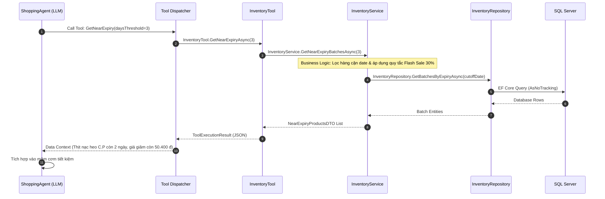

# 10_AI - TÀI LIỆU 03: THIẾT KẾ LỚP CÔNG CỤ & GỌI HÀM (TOOL CALLING DESIGN)

---

## MỤC LỤC
1. [Nguyên tắc cốt lõi: Tách biệt Agent - Tool - Service - Repository](#1-nguyên-tắc-cốt-lõi-tách-biệt-agent---tool---service---repository)
2. [Cơ chế hoạt động của Tool Dispatcher](#2-cơ-chế-hoạt-động-của-tool-dispatcher)
3. [Danh mục các Tools chuẩn trong hệ thống](#3-danh-mục-các-tools-chuẩn-trong-hệ-thống)
4. [Đặc tả chi tiết từng Tool](#4-đặc-tả-chi-tiết-từng-tool)
   - [4.1. InventoryTool (Tra cứu tồn kho & Cận Date)](#41-inventorytool)
   - [4.2. ProductTool (Tìm kiếm & Sản phẩm thay thế)](#42-producttool)
   - [4.3. PromotionTool (Voucher & Flash Sale)](#43-promotiontool)
   - [4.4. RecipeTool (Tra cứu công thức Cookpad)](#44-recipetool)
   - [4.5. CartTool (Thao tác giỏ hàng)](#45-carttool)
5. [Quy chuẩn an toàn & Bảo vệ dữ liệu (Security Guardrails)](#5-quy-chuẩn-an-toàn--bảo-vệ-dữ-liệu)

---

## 1. NGUYÊN TẮC CỐT LÕI: TÁCH BIỆT AGENT - TOOL - SERVICE - REPOSITORY

Trong kiến trúc Enterprise AI của **Smart SuperMarket**, quy tắc phân tầng là bất biến:

```text
Agent ──(gọi)──► Tool ──(gọi)──► Service ──(gọi)──► Repository ──(truy vấn)──► Database
```

| Tầng | Vai Trò | Logic Xử Lý | Ví Dụ Minh Họa |
|---|---|---|---|
| **Agent** | Hiểu ý định & Lập kế hoạch | Logic tư duy & điều phối | `ShoppingAgent` nhận thấy cần kiểm tra hàng cận date $\rightarrow$ gọi `InventoryTool` |
| **Tool** | Cổng giao tiếp chuẩn hóa (Interface) | **HOÀN TOÀN KHÔNG CÓ LOGIC** | `InventoryTool.GetNearExpiry(days)` chuyển tiếp tham số sang `InventoryService` |
| **Service** | Xử lý nghiệp vụ kinh doanh | **TOÀN BỘ BUSINESS LOGIC Ở ĐÂY** | `InventoryService` lọc lô $\le 3$ ngày, tính mức giảm 30%, gắn cờ Flash Sale |
| **Repository** | Đọc/Ghi dữ liệu EF Core | **CHỈ TRUY VẤN, KHÔNG LOGIC** | `_db.InventoryBatches.Where(b => b.ExpiryDate <= target).Include().ToList()` |
| **Database** | Nguồn chân lý duy nhất | Lưu trữ trạng thái | Bảng `Products`, `ProductBatches`, `Promotions` trong SQL Server |

---

## 2. CƠ CHẾ HOẠT ĐỘNG CỦA TOOL DISPATCHER

Khi mô hình LLM (Gemini 2.5 Flash) xử lý prompt của Agent, nếu cần dữ liệu thực tế, LLM sẽ sinh ra một lệnh Function Call (JSON). `Tool Dispatcher` tiếp nhận lệnh, gọi Tool C# tương ứng, và nạp kết quả JSON trở lại cho LLM.



---

## 3. DANH MỤC CÁC TOOLS CHUẨN TRONG HỆ THỐNG

| Tên Tool | Các Phương Thức Cung Cấp | Service Phụ Trách | Mục Đích |
|---|---|---|---|
| `InventoryTool` | `GetStock()`, `GetNearExpiry()`, `GetAlternative()`, `GetAvailableBatch()` | `InventoryService` | Kiểm tra số lượng tồn, lô hàng và hạn dùng |
| `ProductTool` | `Search()`, `GetById()`, `GetAlternative()`, `GetByCategory()` | `ProductService` | Tra cứu thông tin chi tiết và sản phẩm thay thế |
| `PromotionTool` | `GetVouchers()`, `CheckFlashSale()`, `CalculateDiscount()` | `PromotionService` | Áp dụng mã giảm giá và chiến dịch giờ vàng |
| `RecipeTool` | `GetRecipe()`, `GetIngredients()`, `SearchByKeyword()` | `RecipeService` | Tra cứu công thức nấu ăn chuẩn Cookpad |
| `CartTool` | `AddToCart()`, `RemoveFromCart()`, `EstimateCart()` | `OrderService` | Thao tác và tính toán giỏ hàng người dùng |

---

## 4. ĐẶC TẢ CHI TIẾT TỪNG TOOL

### 4.1. InventoryTool
- **Chữ ký phương thức**:
  - `Task<int> GetStockAsync(int productId)`
  - `Task<List<NearExpiryItemDto>> GetNearExpiryAsync(int daysThreshold)`
  - `Task<ProductDto?> GetAlternativeAsync(int outOfStockProductId)`
  - `Task<List<BatchDto>> GetAvailableBatchAsync(int productId)`
- **Đặc điểm**: Chỉ đóng vai trò adapter gọi sang `IInventoryService`.

### 4.2. ProductTool
- **Chữ ký phương thức**:
  - `Task<List<ProductDto>> SearchAsync(string keyword, int? categoryId)`
  - `Task<ProductDto?> GetByIdAsync(int productId)`
  - `Task<ProductDto?> GetAlternativeAsync(int currentProductId, decimal maxPrice)`
- **Quy tắc cách ly**: Luôn yêu cầu `categoryId` để đảm bảo thực phẩm không bị phân loại nhầm danh mục (Category 9 = Thịt/Trứng/Thủy sản, Category 4 = Rau củ tươi).

### 4.3. PromotionTool
- **Chữ ký phương thức**:
  - `Task<List<VoucherDto>> GetVouchersAsync(int customerId)`
  - `Task<FlashSaleReportDto> CheckFlashSaleAsync()`
  - `Task<decimal> CalculateDiscountAsync(List<CartItemDto> items, string voucherCode)`

### 4.4. RecipeTool
- **Chữ ký phương thức**:
  - `Task<RecipeDto?> GetRecipeAsync(string dishName)`
  - `Task<List<IngredientDto>> GetIngredientsAsync(int recipeId, int servings)`
- **Đảm bảo**: Dữ liệu nguyên liệu lấy từ CSDL công thức chuẩn (Cookpad Knowledge Base), ngăn chặn hoàn toàn việc AI bịa ra món ăn không tưởng.

### 4.5. CartTool
- **Chữ ký phương thức**:
  - `Task<bool> AddToCartAsync(int cartId, List<CartItemDto> items)`
  - `Task<CartEstimationDto> EstimateCartAsync(List<CartItemDto> items)`

---

## 5. QUY CHUẨN AN TOÀN & BẢO VỆ DỮ LIỆU (SECURITY GUARDRAILS)
1. **Chế độ Read-Only cho truy vấn**: Các Tool tra cứu chỉ gọi Repository với `.AsNoTracking()`, không thể làm thay đổi trạng thái dữ liệu kho.
2. **Ngăn chặn rò rỉ giá vốn**: Dữ liệu giá vốn (`CostPrice`) và thông tin nhà cung cấp nội bộ bị loại bỏ hoàn toàn khỏi DTO trả về cho Agent khách hàng.
3. **Giới hạn số lượng bản ghi (Pagination)**: Mỗi lần truy vấn Tool chỉ trả về tối đa 15 sản phẩm phù hợp nhất, tránh làm tràn Context Token của LLM.
