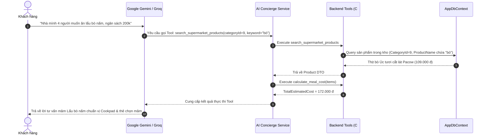

# 10_AI - TÀI LIỆU 03: THIẾT KẾ GỌI HÀM & CÔNG CỤ (TOOL CALLING DESIGN)

---

## MỤC LỤC
1. [Nguyên lý hoạt động của Tool Calling](#1-nguyên-lý-hoạt-động-của-tool-calling)
2. [Danh mục các Tools trong hệ thống](#2-danh-mục-các-tools-trong-hệ-thống)
3. [Đặc tả chi tiết & JSON Schema từng Tool](#3-đặc-tả-chi-tiết--json-schema-từng-tool)
   - 3.1. [Tool: search_supermarket_products](#31-tool-search_supermarket_products)
   - 3.2. [Tool: check_inventory_batches](#32-tool-check_inventory_batches)
   - 3.3. [Tool: calculate_meal_cost](#33-tool-calculate_meal_cost)
   - 3.4. [Tool: filter_flash_sale_near_expiry](#34-tool-filter_flash_sale_near_expiry)
   - 3.5. [Tool: generate_draft_import_order](#35-tool-generate_draft_import_order)
4. [Luồng thực thi & Cơ chế bẫy lỗi (Execution Flow & Error Handling)](#4-luồng-thực-thi--cơ-chế-bẫy-lỗi)
5. [Quy chuẩn an toàn (Security Guardrails)](#5-quy-chuẩn-an-toàn-security-guardrails)

---

## 1. NGUYÊN LÝ HOẠT ĐỘNG CỦA TOOL CALLING

Mô hình Ngôn ngữ Lớn (LLM) không thể tự động truy cập dữ liệu thời gian thực hay tự động chèn đơn hàng vào giỏ hàng. Cơ chế **Tool Calling** (Function Calling) cho phép LLM quyết định khi nào cần gọi hàm nghiệp vụ phía Backend C#, tiếp nhận kết quả trả về và tổng hợp thành lời khuyên chuẩn xác nhất.



---

## 2. DANH MỤC CÁC TOOLS TRONG HỆ THỐNG

| Tên Tool | Tác nhân sử dụng | Mục đích nghiệp vụ |
| :--- | :--- | :--- |
| `search_supermarket_products` | Chef & Concierge Agent | Tìm kiếm sản phẩm theo từ khóa và cách ly đúng `CategoryId` |
| `check_inventory_batches` | Chef & Retail Copilot | Kiểm tra số lượng tồn và hạn dùng chi tiết của từng lô hàng |
| `calculate_meal_cost` | Chef & Concierge Agent | Tính toán chi phí mâm cơm, mức chiết khấu và số tiền tiết kiệm |
| `filter_flash_sale_near_expiry` | Chef & Concierge Agent | Lọc các mặt hàng cận date $\le 7$ ngày để áp dụng giảm 30% |
| `generate_draft_import_order` | Retail Operations Copilot | Tự động tính toán lượng thiếu hụt và lập phiếu nhập kho nháp |

---

## 3. ĐẶC TẢ CHI TIẾT & JSON SCHEMA TỪNG TOOL

### 3.1. Tool: search_supermarket_products
- **Mục đích**: Tìm kiếm sản phẩm trong kho siêu thị với bộ lọc danh mục chặt chẽ, loại bỏ hoàn toàn lỗi ghép nhầm mì tôm sang thịt tươi hoặc cá hộp sang cà chua.
- **Khai báo JSON Schema**:
```json
{
  "name": "search_supermarket_products",
  "description": "Tìm kiếm sản phẩm thực tế từ kho siêu thị theo danh mục và từ khóa chính xác",
  "parameters": {
    "type": "object",
    "properties": {
      "categoryId": {
        "type": "integer",
        "description": "Mã danh mục: 9=Thịt/Cá/Trứng, 4=Rau củ tươi, 10=Đồ ăn liền/hộp, 5=Gia vị"
      },
      "keyword": {
        "type": "string",
        "description": "Từ khóa tên sản phẩm (ví dụ: 'ba chỉ', 'cà chua', 'trứng gà', 'sườn non')"
      },
      "excludeWord": {
        "type": "string",
        "description": "Từ khóa loại trừ (ví dụ: loại trừ 'mì' khi tìm kiếm sườn)"
      }
    },
    "required": ["keyword"]
  }
}
```

### 3.2. Tool: check_inventory_batches
- **Mục đích**: Tra cứu tồn kho chi tiết theo từng lô hàng của sản phẩm.
- **Tham số đầu vào**: `productId` (int), `branchId` (int).
- **Kết quả trả về**:
```json
{
  "productId": 81,
  "productName": "Thịt ba chỉ heo MeatDeli khay 400g",
  "totalStock": 35,
  "batches": [
    {
      "batchCode": "LOT-0081",
      "quantity": 35,
      "expiryDate": "2026-11-04T00:00:00Z",
      "daysLeft": 8,
      "status": "Good"
    }
  ]
}
```

### 3.3. Tool: calculate_meal_cost
- **Mục đích**: Tính toán chi phí mâm cơm và số tiền tiết kiệm được từ Flash Sale.
- **Công thức chuẩn**:
  $$\text{LineTotal} = \text{FinalPrice} \times \text{QuantityToBuy}$$
  $$\text{TotalEstimatedCost} = \sum \text{LineTotal}$$
  $$\text{TotalSavedAmount} = \sum (\text{RegularPrice} - \text{FinalPrice}) \times \text{QuantityToBuy}$$

### 3.4. Tool: filter_flash_sale_near_expiry
- **Mục đích**: Lọc các mặt hàng có hạn sử dụng còn lại $\le 7$ ngày để ưu tiên ghép vào thực đơn *"Bữa cơm giải cứu - Tiết kiệm tối đa"*.
- **Ràng buộc**: Tự động áp dụng mức giảm 30% (`DiscountPercent = 30%`).

### 3.5. Tool: generate_draft_import_order
- **Mục đích**: Lập phiếu nhập kho nháp tự động cho bộ phận thu mua.
- **Tham số đầu vào**: `supplierId` (int), `thresholdDays` (int).
- **Kết quả trả về**: Đối tượng `AiDraftImportOrder` bao gồm các mặt hàng cần nhập, đơn giá hợp đồng và tổng giá trị thanh toán dự kiến.

---

## 4. LUỒNG THỰC THI & CƠ CHẾ BẪY LỖI (ERROR HANDLING)

1. **Validation Gate**: Mọi tham số từ LLM trước khi chuyển cho C# Service đều phải được kiểm tra kiểu dữ liệu (`int.TryParse`, null check).
2. **Missing Product Fallback**: Nếu một từ khóa không tìm thấy sản phẩm trong kho (ví dụ: siêu thị tạm hết bắp ngọt), Tool tự động trả về `null` và Service chọn sản phẩm thay thế tương đương cùng nhóm mà không làm đổ vỡ toàn bộ mâm cơm.
3. **Timeout Protection**: Giới hạn thời gian thực thi Tool $\le 500\text{ms}$.

---

## 5. QUY CHUẨN AN TOÀN (SECURITY GUARDRAILS)

- **Quyền đọc độc quyền (Read-Only Safety)**: Toàn bộ các Tool phía Client chỉ có quyền đọc dữ liệu (`AsNoTracking()`), không thể thực hiện INSERT, UPDATE, DELETE CSDL.
- **Duyệt qua người dùng (Human-In-The-Loop)**: Mọi hành vi tạo phiếu nhập kho hoặc nạp giỏ hàng đều yêu cầu xác nhận chủ động từ Quản lý hoặc Khách hàng.
