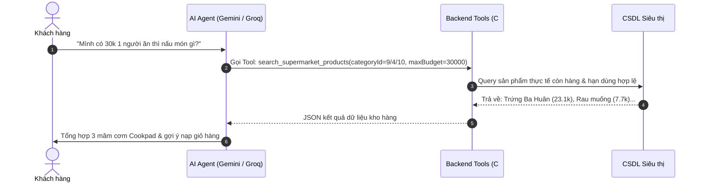

# 10_AI - TÀI LIỆU 03: ĐẶC TẢ CÔNG CỤ & GỌI HÀM THÔNG MINH (TOOL CALLING & FUNCTIONS)

---

## MỤC LỤC
1. [Khái niệm & Cơ chế hoạt động (Function Calling Overview)](#1-khái-niệm--cơ-chế-hoạt-động)
2. [Danh mục các công cụ hệ thống (Tool Catalog)](#2-danh-mục-các-công-cụ-hệ-thống)
3. [Chi tiết đặc tả các Tools](#3-chi-tiết-đặc-tả-các-tools)
   - 3.1. [Tool: search_supermarket_products](#31-tool-search_supermarket_products)
   - 3.2. [Tool: check_inventory_batches](#32-tool-check_inventory_batches)
   - 3.3. [Tool: calculate_meal_cost](#33-tool-calculate_meal_cost)
   - 3.4. [Tool: filter_flash_sale_near_expiry](#34-tool-filter_flash_sale_near_expiry)
   - 3.5. [Tool: generate_draft_import_order](#35-tool-generate_draft_import_order)
4. [Nguyên tắc an toàn & Kiểm soát thực thi (Security & Execution Guardrails)](#4-nguyên-tắc-an-toàn--kiểm-soát-thực-thi)

---

## 1. KHÁI NIỆM & CƠ CHẾ HOẠT ĐỘNG

Mô hình Ngôn ngữ Lớn (LLM) tuy giỏi suy luận ngôn ngữ nhưng không thể trực tiếp truy cập vào cơ sở dữ liệu kho hàng thời gian thực hay tự động thực thi việc thêm sản phẩm vào giỏ hàng. Cơ chế **Tool Calling** (Function Calling) đóng vai trò là "cánh tay nối dài" cho phép AI tương tác hai chiều với hệ thống Backend thông qua các hàm C# được định nghĩa chặt chẽ.



---

## 2. DANH MỤC CÁC CÔNG CỤ HỆ THỐNG

| Tên Tool | Phạm vi áp dụng | Mục đích nghiệp vụ |
| :--- | :--- | :--- |
| `search_supermarket_products` | Customer Concierge | Tìm kiếm sản phẩm theo danh mục và từ khóa chính xác |
| `check_inventory_batches` | Customer & POS | Kiểm tra hạn sử dụng và số lượng tồn theo từng lô hàng |
| `calculate_meal_cost` | Customer Concierge | Tính toán chi phí mâm cơm, số tiền tiết kiệm và chiết khấu |
| `filter_flash_sale_near_expiry` | Customer & Operations | Lọc các mặt hàng cận date giảm giá sốc từ 30% - 50% |
| `generate_draft_import_order` | Retail Operations Copilot | Tự động tính toán nhu cầu nhập hàng và lập phiếu nháp |

---

## 3. CHI TIẾT ĐẶC TẢ CÁC TOOLS

### 3.1. Tool: search_supermarket_products
- **Mục đích**: Tìm kiếm sản phẩm theo ràng buộc danh mục chặt chẽ (Tránh trường hợp tìm sườn ra mì tôm, tìm cà chua ra cá hộp).
- **JSON Schema khai báo**:
```json
{
  "name": "search_supermarket_products",
  "description": "Tìm kiếm sản phẩm thực tế từ kho hàng siêu thị theo danh mục và từ khóa",
  "parameters": {
    "type": "object",
    "properties": {
      "categoryId": {
        "type": "integer",
        "description": "Mã danh mục: 9=Thịt/Cá/Trứng, 4=Rau củ quả tươi, 10=Đồ ăn liền/Hộp, 5=Gia vị"
      },
      "keyword": {
        "type": "string",
        "description": "Từ khóa tên sản phẩm (ví dụ: 'ba chỉ', 'cà chua', 'trứng gà')"
      },
      "excludeWord": {
        "type": "string",
        "description": "Từ khóa loại trừ (ví dụ: loại trừ 'mì' khi tìm sườn)"
      }
    },
    "required": ["keyword"]
  }
}
```

### 3.2. Tool: check_inventory_batches
- **Mục đích**: Tra cứu tồn kho chi tiết theo từng lô hàng của sản phẩm.
- **Tham số đầu vào**: `productId` (int), `branchId` (int, mặc định = 1).
- **Kết quả trả về**: Danh sách lô hàng gồm `BatchCode`, `TotalStock`, `ManufacturingDate`, `ExpiryDate`, `DaysRemaining`.

### 3.3. Tool: calculate_meal_cost
- **Mục đích**: Tính toán tổng ngân sách, thành tiền của từng món ăn và mức tiết kiệm nhờ ưu đãi Flash Sale cận date.
- **Công thức tính**:
  $$\text{LineTotal} = \text{FinalPrice} \times \text{QuantityToBuy}$$
  $$\text{TotalEstimatedCost} = \sum \text{LineTotal}$$
  $$\text{TotalSavedAmount} = \sum (\text{RegularPrice} - \text{FinalPrice}) \times \text{QuantityToBuy}$$

### 3.4. Tool: filter_flash_sale_near_expiry
- **Mục đích**: Lọc các mặt hàng có hạn sử dụng còn lại $\le 7$ ngày để ưu tiên ghép vào thực đơn *"Bữa cơm giải cứu - Tiết kiệm tối đa"*.
- **Ràng buộc**: Tự động áp dụng mức giảm 30% nếu được kích hoạt cờ `prioritizePromotions = true`.

### 3.5. Tool: generate_draft_import_order
- **Mục đích**: Tạo phiếu nhập kho nháp tự động cho bộ phận thu mua.
- **Tham số đầu vào**: `supplierId` (int), `thresholdDays` (int, chu kỳ dự phòng nhập kho).
- **Kết quả trả về**: Thực thể `AiDraftImportOrder` chứa các mặt hàng cần nhập, đơn giá hợp đồng và tổng giá trị thanh toán dự kiến.

---

## 4. NGUYÊN TẮC AN TOÀN & KIỂM SOÁT THỰC THI (GUARDRAILS)

1. **Read-Only By Default**: Mọi câu hỏi tư vấn thông thường chỉ có quyền đọc dữ liệu (Query), tuyệt đối không được phép chỉnh sửa hoặc xóa dữ liệu tồn kho.
2. **Explicit User Confirmation**: AI không tự ý tạo giao dịch thanh toán hoặc trừ tiền tài khoản của khách. Thao tác nạp giỏ hàng chỉ diễn ra khi người dùng chủ động bấm nút `"Chọn mâm này"`.
3. **Thao tác Quản lý có kiểm duyệt**: Phiếu nhập hàng nháp do AI đề xuất (`generate_draft_import_order`) chỉ lưu dưới trạng thái `Draft`, yêu cầu Quản lý kho xác nhận và phê duyệt trước khi ghi nhận tăng tồn kho chính thức.
