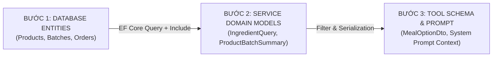

# 10_AI - TÀI LIỆU 04: ÁNH XẠ DỮ LIỆU CSDL → SERVICE → TOOL (DATABASE MAPPING)

---

## MỤC LỤC
1. [Chuỗi chuyển đổi dữ liệu 3 bước (3-Step Data Transformation Pipeline)](#1-chuỗi-chuyển-đổi-dữ-liệu-3-bước)
2. [Bảng ánh xạ chi tiết từng thực thể CSDL](#2-bảng-ánh-xạ-chi-tiết-từng-thực-thể-csdl)
   - 2.1. [Products & Categories → IngredientQuery → search_supermarket_products](#21-products--categories--ingredientquery--search_supermarket_products)
   - 2.2. [InventoryBatches → ProductBatchSummary → check_inventory_batches](#22-inventorybatches--productbatchsummary--check_inventory_batches)
   - 2.3. [DiscountRules → DiscountRuleDto → filter_flash_sale_near_expiry](#23-discountrules--discountruledto--filter_flash_sale_near_expiry)
   - 2.4. [OrderDetails → BasketItemPair → Market Basket Analysis](#24-orderdetails--basketitempair--market-basket-analysis)
   - 2.5. [ImportReceipts & Details → AiDraftImportOrder → generate_draft_import_order](#25-importreceipts--details--aidraftimportorder--generate_draft_import_order)
3. [Quy tắc cách ly Danh mục (Category Isolation Matrix)](#3-quy-tắc-cách-ly-danh-mục-category-isolation-matrix)
4. [Tối ưu hóa Token & Định dạng Compact Context](#4-tối-ưu-hóa-token--định-dạng-compact-context)
5. [Tính tương thích CSDL: In-Memory DB & PostgreSQL](#5-tính-tương-thích-csdl-in-memory-db--postgresql)

---

## 1. CHUỖI CHUYỂN ĐỔI DỮ LIỆU 3 BƯỚC

Để đưa dữ liệu CSDL quan hệ vào môi trường suy luận của AI một cách an toàn, chính xác và tiết kiệm token, hệ thống áp dụng chuỗi chuyển đổi chuẩn:



---

## 2. BẢNG ÁNH XẠ CHI TIẾT TỪNG THỰC THỂ CSDL

### 2.1. Products & Categories → IngredientQuery → search_supermarket_products
- **Bảng CSDL gốc**: `Products` (kết hợp `Categories`).
- **Lớp Service trung gian**:
  ```csharp
  private sealed record IngredientQuery(
      int? CategoryId,        // Mã danh mục bắt buộc (4, 9, 10...)
      string Keyword,         // Từ khóa nhận diện món
      int DefaultQty,         // Định lượng mua mặc định
      string? ExcludeWord = null // Từ khóa loại trừ
  );
  ```
- **Ánh xạ sang Tool & Context**:
  - `ProductId` $\rightarrow$ `MealIngredientItemDto.ProductId`
  - `ProductName` $\rightarrow$ `MealIngredientItemDto.ProductName`
  - `Barcode` $\rightarrow$ `MealIngredientItemDto.Barcode`
  - `Price` $\rightarrow$ `MealIngredientItemDto.RegularPrice`
  - `Unit` $\rightarrow$ `MealIngredientItemDto.Unit`
  - `ImageUrl` $\rightarrow$ `MealIngredientItemDto.ImageUrl`

### 2.2. InventoryBatches → ProductBatchSummary → check_inventory_batches
- **Bảng CSDL gốc**: `InventoryBatches`.
- **Lớp Service trung gian**:
  ```csharp
  private sealed record ProductBatchSummary(int TotalStock, DateTime MinExpiry);
  ```
- **Logic ánh xạ**:
  - `TotalStock` = $\sum \text{Quantity}$ (Tổng số lượng tồn thực tế của các lô còn hạn).
  - `MinExpiry` = $\min(\text{ExpiryDate})$ (Lô có hạn sử dụng gần nhất).
  - Nếu $(\text{MinExpiry} - \text{DateTime.UtcNow}).\text{Days} \le 7$ $\rightarrow$ Kích hoạt Flash Sale 30%.

### 2.3. DiscountRules → DiscountRuleDto → filter_flash_sale_near_expiry
- **Bảng CSDL gốc**: `DiscountRules`.
- **Ánh xạ sang Tool**:
  - `DaysBeforeExpiry` $\rightarrow$ Ngưỡng ngày kiểm tra ($\le 7$ ngày).
  - `DiscountPercent` $\rightarrow$ Mức chiết khấu áp dụng ($30\%$).
  - `FinalPrice` = $\text{Round}\left(\text{RegularPrice} \times \frac{100 - \text{DiscountPercent}}{100}\right)$.

### 2.4. OrderDetails → BasketItemPair → Market Basket Analysis
- **Bảng CSDL gốc**: `Orders` và `OrderDetails`.
- **Ánh xạ sang Service**:
  - Gom nhóm các sản phẩm xuất hiện trong cùng một `OrderId`.
  - Đếm tần suất xuất hiện đồng thời $(A, B)$ để tính độ tin cậy $\text{Confidence}(A \rightarrow B) = \frac{P(A \cap B)}{P(A)}$.

### 2.5. ImportReceipts & Details → AiDraftImportOrder → generate_draft_import_order
- **Bảng CSDL gốc**: `ImportReceipts`, `ImportDetails`, `Suppliers`.
- **Ánh xạ sang Service**:
  - Dựa trên sản phẩm có tồn kho $<$ `MinStockLevel` từ nhà cung cấp `SupplierId`.
  - Sinh đối tượng `AiDraftImportOrder` sẵn sàng cho nút bấm 1-Click Commit vào bảng `ImportReceipts`.

---

## 3. QUY TẮC CÁCH LY DANH MỤC (CATEGORY ISOLATION MATRIX)

Quy tắc sống còn để triệt tiêu lỗi nhận diện sai sản phẩm:

| Nhóm nguyên liệu | CategoryId bắt buộc | Ví dụ từ khóa | Ví dụ từ loại trừ | Sản phẩm chính xác được ghép |
| :--- | :---: | :--- | :--- | :--- |
| **Thịt sườn non tươi** | `9` | `"sườn non"` | `"mì"` | `Sườn non heo tươi C.P khay 500g` |
| **Thịt ba chỉ / ba rọi** | `9` | `"ba chỉ"`, `"ba rọi"`| - | `Thịt ba chỉ heo MeatDeli khay 400g` |
| **Trứng gà tươi** | `9` | `"trứng gà"` | - | `Trứng gà tươi Ba Huân vỉ 10 quả` |
| **Thịt bò Úc** | `9` | `"bò"` | - | `Thịt bò Úc tươi cắt lát Pacow khay 250g` |
| **Cà chua tươi** | `4` | `"cà chua"` | `"cá"` | `Cà chua Beef Đà Lạt tươi ngon 1kg` |
| **Rau muống nước** | `4` | `"rau muống"` | - | `Rau muống nước tươi Bách Hóa Xanh bó 500g` |
| **Cải ngọt** | `4` | `"cải ngọt"` | - | `Cải ngọt Đà Lạt đạt chuẩn VietGAP túi 500g` |
| **Mì nấu nhanh** | `10` | `"omachi"`, `"hảo hảo"`| - | `Mì Omachi sườn hầm ngũ quả gói 80g` |
| **Xúc xích** | `10` | `"xúc xích"` | - | `Xúc xích tiệt trùng Vissan Heo gói 5 cây` |
| **Cá hộp** | `10` | `"cá nục"` | - | `Cá nục sốt cà chua Ba Cô Gái lon 155g` |

---

## 4. TỐI ƯU HÓA TOKEN & ĐỊNH DẠNG COMPACT CONTEXT

Thay vì nhồi nhét toàn bộ 200 sản phẩm với hàng nghìn ký tự JSON vào câu lệnh gửi LLM, hệ thống sử dụng định dạng chuỗi nén siêu nhẹ:

```csharp
// Chỉ lấy 12 sản phẩm đại diện phù hợp chủ đề đưa vào Prompt LLM
string compactContext = string.Join(", ", dbProducts.Take(12).Select(p => $"{p.ProductName} ({p.Price:N0} đ/{p.Unit})"));
```

Tiết kiệm hơn 85% dung lượng Token đầu vào, giảm chi phí API và rút ngắn thời gian phản hồi còn dưới 1.2 giây.

---

## 5. TÍNH TƯƠNG THÍCH CSDL: IN-MEMORY DB & POSTGRESQL

Trong môi trường kiểm thử và Demo cục bộ, hệ thống có thể chạy trên `UseInMemoryDatabase("SmartSupermarketDb")` hoặc máy chủ `PostgreSQL`:
- Nhằm tránh việc tiến trình nền `ShelfLifeBackgroundService` quét tự động và đánh dấu `ProductStatus.Inactive` với các sản phẩm seed có date cũ, tại [AiShoppingConciergeService.cs](file:///D:/Laptrinhtrucquan/Backend/Features/AI/Services/AiShoppingConciergeService.cs) hệ thống truy vấn toàn bộ danh mục sản phẩm:
  ```csharp
  var dbProducts = await _dbContext.Products
      .Include(p => p.Category)
      .ToListAsync(cancellationToken);
  ```
- Nhờ vậy, AI luôn có sẵn đầy đủ nguồn dữ liệu thực phẩm tươi ngon để phục vụ thực khách trong mọi môi trường triển khai.
