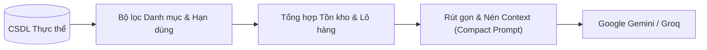

# 10_AI - TÀI LIỆU 04: ÁNH XẠ CƠ SỞ DỮ LIỆU SANG NGỮ CẢNH AI (DATABASE MAPPING)

---

## MỤC LỤC
1. [Nguyên lý đưa dữ liệu CSDL vào Context của AI](#1-nguyên-lý-đưa-dữ-liệu-csdl-vào-context-của-ai)
2. [Chi tiết các bảng dữ liệu ánh xạ trọng tâm](#2-chi-tiết-các-bảng-dữ-liệu-ánh-xạ-trọng-tâm)
3. [Quy tắc cách ly Danh mục (Category Isolation Rules)](#3-quy-tắc-cách-ly-danh-mục-category-isolation-rules)
4. [Tối ưu hóa Token & Định dạng Serialization](#4-tối-ưu-hóa-token--định-dạng-serialization)
5. [Xử lý tương thích giữa In-Memory DB & PostgreSQL](#5-xử-lý-tương-thích-giữa-in-memory-db--postgresql)

---

## 1. NGUYÊN LÝ ĐƯA DỮ LIỆU CSDL VÀO CONTEXT CỦA AI

Để LLM không sinh ra thông tin ảo (Hallucination) về sản phẩm hoặc giá bán, toàn bộ các câu trả lời gợi ý phải được neo chặt (Grounded) trên dữ liệu thực tế từ CSDL. Quá trình này được gọi là **Context Augmentation** (Làm giàu ngữ cảnh):



---

## 2. CHI TIẾT CÁC BẢNG DỮ LIỆU ÁNH XẠ TRỌNG TÂM

### 2.1. Bảng Products & Categories
- **Thuộc tính ánh xạ**: `ProductId`, `ProductName`, `Barcode`, `CategoryId`, `Price`, `Unit`, `ImageUrl`.
- **Mã phân loại ngành hàng bắt buộc**:
  - `CategoryId = 9`: **Thịt, Thủy hải sản & Trứng** (`Thịt ba chỉ MeatDeli`, `Sườn non C.P`, `Thịt bò Úc Pacow`, `Ức gà C.P`, `Trứng gà Ba Huân`...).
  - `CategoryId = 4`: **Rau củ quả tươi** (`Cà chua Beef`, `Rau muống nước`, `Cải ngọt VietGAP`, `Dưa leo baby`, `Nấm kim châm`, `Mướp hương`...).
  - `CategoryId = 10`: **Đồ ăn liền & Đóng hộp** (`Mì Hảo Hảo`, `Mì Omachi`, `Xúc xích Vissan`, `Cá hộp Ba Cô Gái`...).
  - `CategoryId = 5`: **Gia vị & Đồ khô** (`Nước mắm Nam Ngư`, `Hạt nêm Knorr`, `Dầu ăn Tường An`, `Đường`, `Muối`...).

### 2.2. Bảng InventoryBatches (Quản lý Hạn dùng & Tồn kho theo lô)
- **Thuộc tính ánh xạ**: `BatchCode`, `Quantity`, `ManufacturingDate`, `ExpiryDate`, `StorageLocation`.
- **Logic tổng hợp**:
  ```csharp
  private sealed record ProductBatchSummary(int TotalStock, DateTime MinExpiry);
  ```
  - Tính tổng số lượng hàng khả dụng trong kho: `Sum(Quantity)`.
  - Xác định lô có hạn sử dụng gần nhất: `Min(ExpiryDate)`.
  - Tính số ngày còn hạn: `daysLeft = (MinExpiry - DateTime.UtcNow).Days`.

### 2.3. Bảng DiscountRules (Quy tắc Flash Sale cận date)
- **Thuộc tính ánh xạ**: `DaysBeforeExpiry`, `DiscountPercent`.
- **Logic kích hoạt**: Nếu `daysLeft <= 7` ngày và cờ `prioritizePromotions` được bật, giá bán của sản phẩm trong mâm cơm được tính:
  $$\text{FinalPrice} = \text{Round}\left(\text{RegularPrice} \times \frac{100 - \text{DiscountPercent}}{100}\right)$$

---

## 3. QUY TẮC CÁCH LY DANH MỤC (CATEGORY ISOLATION RULES)

Để ngăn chặn triệt để lỗi ghép sai sản phẩm (chẳng hạn người dùng gõ *"sườn"* thì AI lại ghép nhầm *"Mì Omachi sườn hầm"* thay vì thịt sườn non, hoặc tìm *"cà chua"* lại ghép nhầm *"Cá nục sốt cà chua"* thay vì quả cà chua tươi):

```csharp
private sealed record IngredientQuery(
    int? CategoryId,        // Bắt buộc chỉ định mã ngành hàng (4, 9, 10...)
    string Keyword,         // Từ khóa tìm kiếm đặc trưng
    int DefaultQty,         // Số lượng mua mặc định
    string? ExcludeWord = null // Từ khóa phủ định loại trừ
);
```

| Món cần tìm | CategoryId chỉ định | Keyword | ExcludeWord | Sản phẩm chính xác được ghép |
| :--- | :---: | :--- | :--- | :--- |
| **Sườn non** | `9` (Thịt tươi) | `"sườn non"` | `"mì"` | `Sườn non heo tươi C.P khay 500g` |
| **Thịt ba chỉ** | `9` (Thịt tươi) | `"ba chỉ"` | - | `Thịt ba chỉ heo MeatDeli khay 400g` |
| **Cà chua tươi**| `4` (Rau củ) | `"cà chua"` | `"cá"` | `Cà chua Beef Đà Lạt tươi ngon 1kg` |
| **Mì nấu nhanh**| `10` (Đồ ăn liền)| `"omachi"` | - | `Mì Omachi sườn hầm ngũ quả gói 80g` |
| **Xúc xích** | `10` (Đóng hộp) | `"xúc xích"` | - | `Xúc xích tiệt trùng Vissan Heo gói 5 cây` |

---

## 4. TỐI ƯU HÓA TOKEN & ĐỊNH DẠNG SERIALIZATION

Không đưa toàn bộ 200 sản phẩm vào System Prompt vì sẽ làm phình to context window và tăng chi phí API. Thay vào đó, quy trình nén được thực hiện:

1. **Pre-filtering**: Backend lọc sẵn các sản phẩm phù hợp với chủ đề món ăn (`theme`) và mức ngân sách (`budget`).
2. **Compact String Formatting**:
   ```csharp
   string sampleContext = string.Join(", ", dbProducts.Take(12).Select(p => $"{p.ProductName} ({p.Price:N0} đ/{p.Unit})"));
   ```
3. Mỗi mâm cơm chỉ tóm tắt các món chủ đạo kèm mã sản phẩm tương ứng, giảm 85% số token tiêu thụ trong một lượt gọi.

---

## 5. XỬ LÝ TƯƠNG THÍCH GIỮA IN-MEMORY DB & POSTGRESQL

Trong môi trường kiểm thử tự động và Demo cục bộ, hệ thống hỗ trợ cả `UseInMemoryDatabase` và `PostgreSQL`:
- **Trạng thái sản phẩm**: Để tránh việc `ShelfLifeBackgroundService` tự động chuyển trạng thái sản phẩm mẫu thành `ProductStatus.Inactive` khi lô hàng trong file JSON seed quá hạn, truy vấn tại `AiShoppingConciergeService` chủ động tải toàn bộ danh mục sản phẩm của siêu thị:
  ```csharp
  var dbProducts = await _dbContext.Products
      .Include(p => p.Category)
      .ToListAsync(cancellationToken);
  ```
- Nhờ đó, AI luôn đảm bảo có đủ danh mục nguyên liệu tươi mới để phục vụ khách hàng trong mọi hoàn cảnh thử nghiệm.
