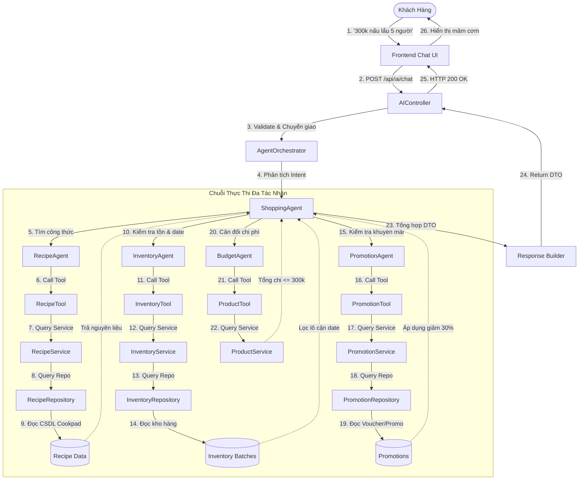
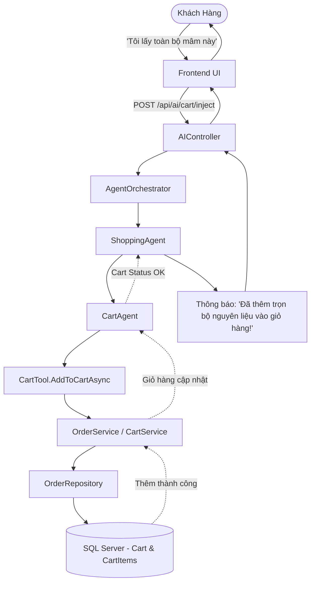
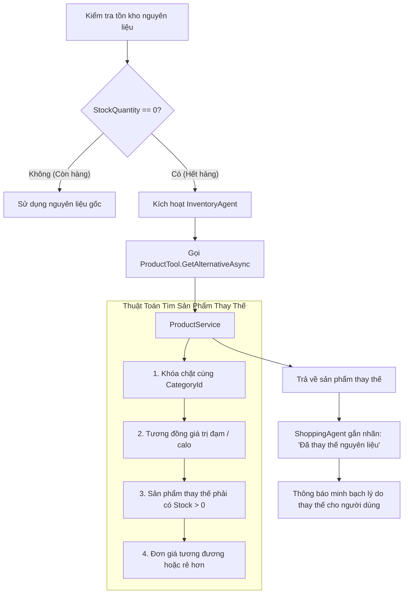

# 10_AI - TÀI LIỆU 06: QUY TRÌNH NGHIỆP VỤ & LUỒNG XỬ LÝ (AI WORKFLOWS)

---

## MỤC LỤC
1. [Luồng đầy đủ: Tư vấn mâm cơm đa tác nhân (End-to-End Meal Planning Workflow)](#1-luồng-đầy-đủ-tư-vấn-mâm-cơm-đa-tác-nhân)
2. [Luồng nạp giỏ hàng: 1-Click Add Cart (Add Cart Workflow)](#2-luồng-nạp-giỏ-hàng-1-click-add-cart)
3. [Luồng xử lý khi hết hàng & Đề xuất thay thế (Out of Stock & Alternative Workflow)](#3-luồng-xử-lý-khi-hết-hàng--đề-xuất-thay-thế)
4. [Luồng tự động giám sát hạn dùng & Flash Sale (Shelf-Life Workflow)](#4-luồng-tự-động-giám-sát-hạn-dùng--flash-sale)

---

## 1. LUỒNG ĐẦY ĐỦ: TƯ VẤN MÂM CƠM ĐA TÁC NHÂN

Áp dụng cho tình huống khách hàng gửi yêu cầu mua sắm và nấu ăn (Ví dụ: *"Tôi có 300k, muốn nấu lẩu cho 5 người, có giảm giá thì ưu tiên"*).

---

## 2. LUỒNG NẠP GIỎ HÀNG: 1-CLICK ADD CART

Áp dụng khi khách hàng bấm nút **"Chọn mâm này"** hoặc gửi tin nhắn *"Tôi lấy toàn bộ mâm lẩu này"*.

---

## 3. LUỒNG XỬ LÝ KHI HẾT HÀNG & ĐỀ XUẤT THAY THẾ (OUT OF STOCK & ALTERNATIVE)

Khi một nguyên liệu trong công thức nấu ăn bị hết hàng tại siêu thị, hệ thống tự động tìm kiếm món thay thế tương đương cùng ngành hàng:

---

## 4. LUỒNG TỰ ĐỘNG GIÁM SÁT HẠN DÙNG & FLASH SALE (SHELF-LIFE WORKFLOW)

Quy trình tự động chạy ngầm bảo vệ hàng hóa và giải cứu thực phẩm tươi sống:
1. **06:00 AM Hàng ngày**: `ShelfLifeBackgroundService` quét toàn bộ bảng `ProductBatches`.
2. **Tính số ngày còn lại**: $\text{DaysLeft} = \text{ExpiryDate} - \text{Today}$.
3. **Phân loại**:
   - $\text{DaysLeft} \le 0$: Khóa bán ngay lập tức (`Status = Expired`).
   - $0 < \text{DaysLeft} \le 1$: Kích hoạt Flash Sale xả hàng **giảm 50%**.
   - $1 < \text{DaysLeft} \le 3$: Kích hoạt Flash Sale **giảm 30%**.
   - $\text{DaysLeft} > 3$: Trạng thái an toàn bình thường.
4. `PromotionAgent` và `ShoppingAgent` tự động nhận diện các lô hàng này để đưa vào danh mục mâm cơm gợi ý cho khách hàng trong ngày.
