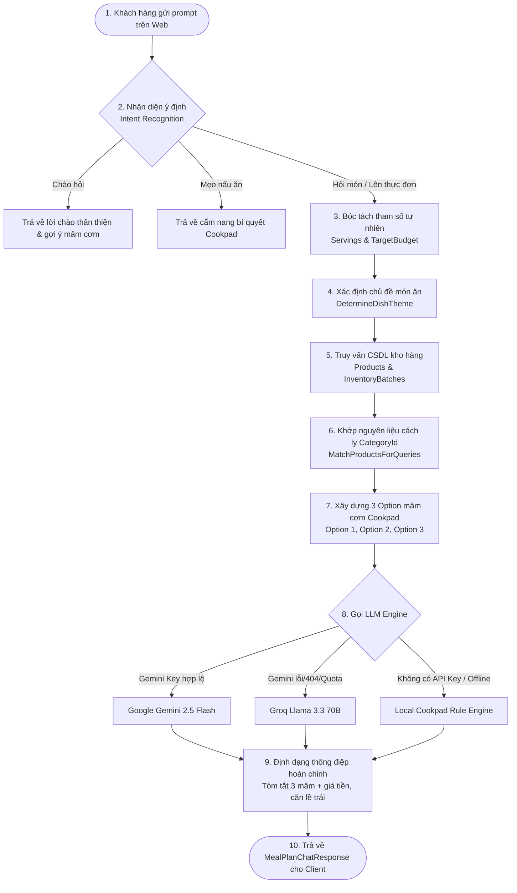
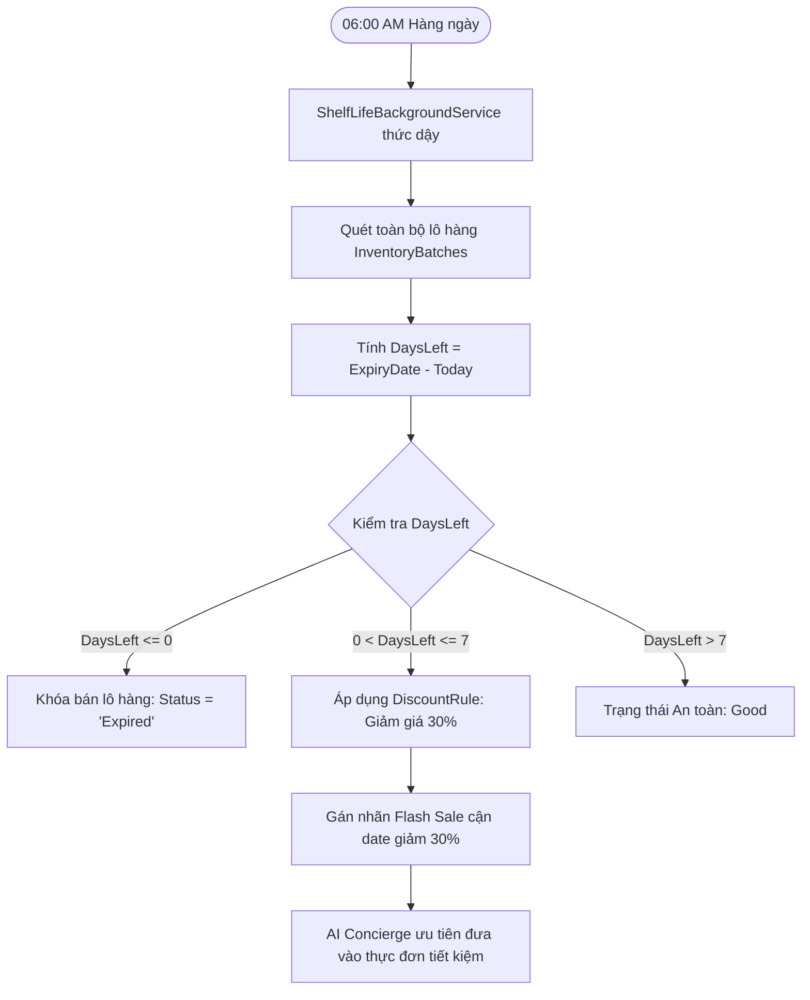
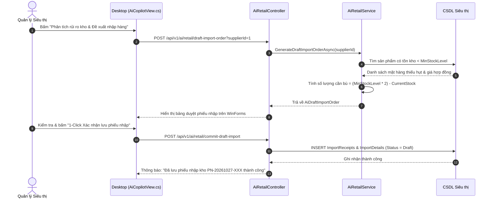
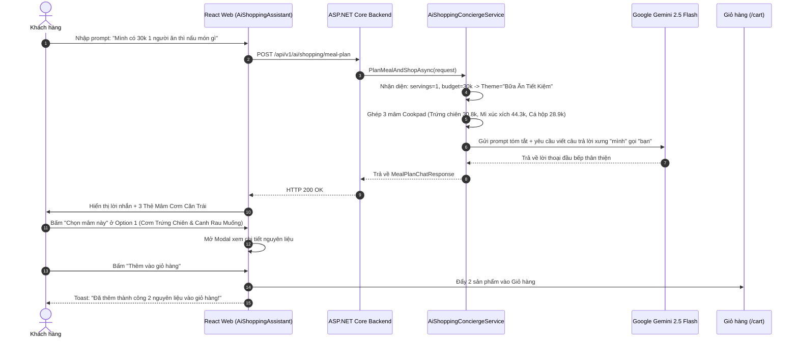

# 10_AI - TÀI LIỆU 06: QUY TRÌNH NGHIỆP VỤ & LUỒNG XỬ LÝ (AI WORKFLOWS)

---

## MỤC LỤC
1. [Luồng 1: Xử lý yêu cầu đi chợ & Lên thực đơn mâm cơm (Shopping Concierge Workflow)](#1-luồng-1-xử-lý-yêu-cầu-đi-chợ--lên-thực-đơn-mâm-cơm)
2. [Luồng 2: Tự động giám sát hạn sử dụng & Kích hoạt Flash Sale (Shelf-Life Workflow)](#2-luồng-2-tự-động-giám-sát-hạn-sử-dụng--kích-hoạt-flash-sale)
3. [Luồng 3: Quản trị viên phân tích tồn kho & Lập phiếu nhập kho 1-Click](#3-luồng-3-quản-trị-viên-phân-tích-tồn-kho--lập-phiếu-nhập-kho-1-click)
4. [Luồng 4: Tương tác khay nguyên liệu & Nạp giỏ hàng (Cart Injection Workflow)](#4-luồng-4-tương-tác-khay-nguyên-liệu--nạp-giỏ-hàng)
5. [Sơ đồ tuần tự tổng thể (Comprehensive Sequence Diagram)](#5-sơ-đồ-tuần-tự-tổng-thể)

---

## 1. LUỒNG 1: XỬ LÝ YÊU CẦU ĐI CHỢ & LÊN THỰC ĐƠN MÂM CƠM

Đây là luồng nghiệp vụ trung tâm kết nối người dùng Web với trí tuệ nhân tạo:

---

## 2. LUỒNG 2: TỰ ĐỘNG GIÁM SÁT HẠN SỬ DỤNG & KÍCH HOẠT FLASH SALE

Quy trình tự động chạy ngầm bảo vệ hàng hóa và giải cứu thực phẩm tươi sống:

---

## 3. LUỒNG 3: QUẢN TRỊ VIÊN PHÂN TÍCH TỒN KHO & LẬP PHIẾU NHẬP KHO 1-CLICK

Dành cho nhà quản lý siêu thị tại màn hình Desktop WinForms:

---

## 4. LUỒNG 4: TƯƠNG TÁC KHAY NGUYÊN LIỆU & NẠP GIỎ HÀNG (CART INJECTION)

Luồng tương tác trực tiếp trên giao diện [AiShoppingAssistant.tsx](file:///D:/Laptrinhtrucquan/Frontend/src/components/chat/AiShoppingAssistant.tsx):

1. **Hiển thị thẻ mâm cơm**: Client nhận `MealPlanChatResponse`, hiển thị lời chào tóm tắt kèm 3 thẻ mâm cơm căn lề trái (mỗi thẻ có huy hiệu giá tiền xanh và danh sách nguyên liệu rút gọn).
2. **Kích hoạt khay mâm**: Khách bấm nút `"👉 Chọn mâm này (XX.000 đ)"`.
3. **Mở Modal khay nguyên liệu (`handleOpenMealModal`)**:
   - Hiển thị danh sách đầy đủ các nguyên liệu kèm hình ảnh sản phẩm.
   - Cho phép khách hàng:
     * Tăng / giảm số lượng từng món (+ / -).
     * Bỏ bớt món nếu nhà đã có sẵn (ví dụ: đã có nước mắm hoặc rau).
     * Đọc bí quyết nấu ăn chuẩn Cookpad (`CookingTips`).
4. **Nạp giỏ hàng 1-Click (`handleApplyMealToCart`)**:
   - Khách bấm `"🛒 Thêm nguyên liệu đã chọn vào giỏ hàng"`.
   - Hệ thống tự động đẩy các mặt hàng vào giỏ hàng `CartPage`, hiển thị Toast thông báo và nút bấm điều hướng nhanh `/cart`.

---

## 5. SƠ ĐỒ TUẦN TỰ TỔNG THỂ (COMPREHENSIVE SEQUENCE)

