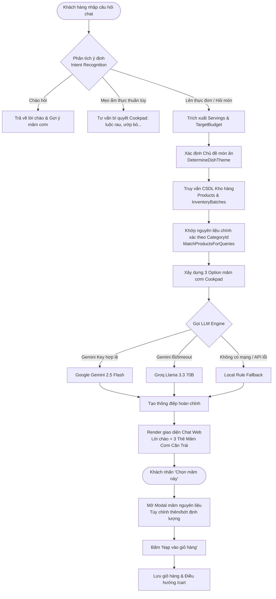
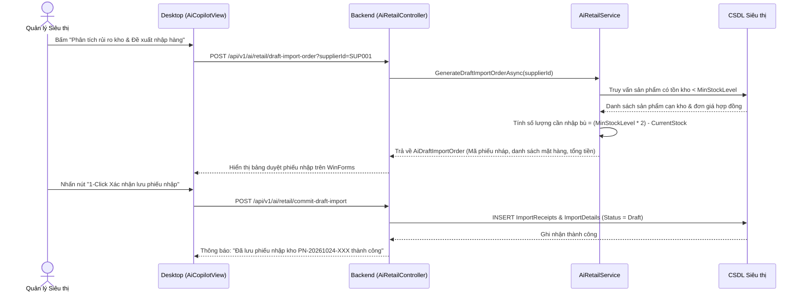
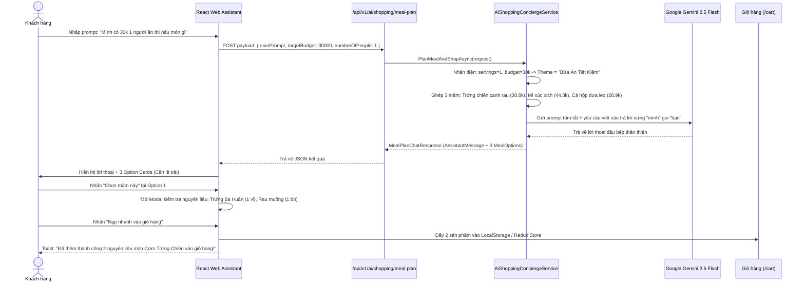

# 10_AI - TÀI LIỆU 06: QUY TRÌNH NGHIỆP VỤ & LUỒNG THI CÔNG (WORKFLOWS)

---

## MỤC LỤC
1. [Quy trình 1: Tư vấn thực đơn & Nạp mâm cơm vào giỏ hàng](#1-quy-trình-1-tư-vấn-thực-đơn--nạp-mâm-cơm-vào-giỏ-hàng)
2. [Quy trình 2: Tự động phát hiện hàng cận date & kích hoạt Flash Sale](#2-quy-trình-2-tự-động-phát-hiện-hàng-cận-date--kích-hoạt-flash-sale)
3. [Quy trình 3: AI Copilot phân tích rủi ro kho & Lập phiếu nhập kho nháp](#3-quy-trình-3-ai-copilot-phân-tích-rủi-ro-kho--lập-phiếu-nhập-kho-nháp)
4. [Sơ đồ tuần tự chi tiết (End-to-End Sequence Diagram)](#4-sơ-đồ-tuần-tự-chi-tiết)

---

## 1. QUY TRÌNH 1: TƯ VẤN THỰC ĐƠN & NẠP MÂM CƠM VÀO GIỎ HÀNG

Đây là luồng tương tác chủ đạo giữa khách hàng mua sắm trên Web và Trợ lý AI:

---

## 2. QUY TRÌNH 2: TỰ ĐỘNG PHÁT HIỆN HÀNG CẬN DATE & KÍCH HOẠT FLASH SALE

Quy trình vận hành ngầm (Background Service) đảm bảo thực phẩm tươi sống được tiêu thụ trước khi hết hạn:

1. **Quét định kỳ (Daily Schedule)**: `ShelfLifeBackgroundService` kích hoạt mỗi sáng sớm.
2. **So khớp hạn sử dụng**: Duyệt qua toàn bộ lô hàng `InventoryBatches`, tính toán:
   $$\text{DaysLeft} = \text{ExpiryDate} - \text{DateTime.UtcNow}$$
3. **Áp dụng quy tắc chiết khấu**:
   - Nếu $\text{DaysLeft} \le 7$ ngày: Gán nhãn `isPromotionOrNearExpiry = true`, áp dụng giảm giá 30% (`DiscountPercent = 30%`).
   - Nếu $\text{DaysLeft} \le 0$ ngày: Tự động chuyển trạng thái lô hàng thành `Expired` và khóa bán.
4. **Đưa vào mâm cơm AI**: Khi khách hàng bật tùy chọn *"Ưu tiên hàng Flash Sale"*, AI ưu tiên chọn các lô hàng này vào thực đơn hàng ngày để khách hàng được hưởng mức giá tốt nhất, đồng thời giải phóng tồn kho cho siêu thị.

---

## 3. QUY TRÌNH 3: AI COPILOT PHÂN TÍCH RỦI RO KHO & LẬP PHIẾU NHẬP KHO NHÁP

Quy trình dành cho Quản lý siêu thị trên ứng dụng Desktop WinForms:

---

## 4. SƠ ĐỒ TUẦN TỰ CHI TIẾT (END-TO-END SEQUENCE)

