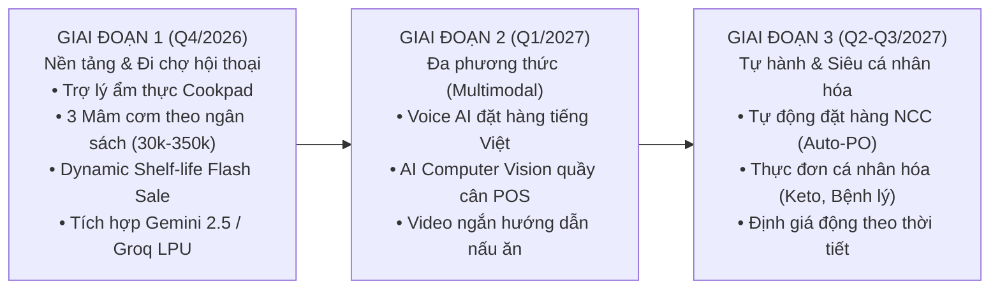

# 10_AI - TÀI LIỆU 09: KẾ HOẠCH TRIỂN KHAI & LỘ TRÌNH NÂNG CẤP (ROADMAP)

---

## MỤC LỤC
1. [Tổng quan kế hoạch 3 giai đoạn](#1-tổng-quan-kế-hoạch-3-giai-đoạn)
2. [Giai đoạn 1: Nền tảng & Đi chợ hội thoại (Đã hoàn thành - Q4/2026)](#2-giai-đoạn-1-nền-tảng--đi-chợ-hội-thoại-q42026)
3. [Giai đoạn 2: Đa phương thức & Trợ lý giọng nói (Q1/2027)](#3-giai-đoạn-2-đa-phương-thức--trợ-lý-giọng-nói-q12027)
4. [Giai đoạn 3: Chuỗi cung ứng tự hành & Siêu cá nhân hóa (Q2 - Q3/2027)](#4-giai-đoạn-3-chuỗi-cung-ứng-tự-hành--siêu-cá-nhân-hóa-q2---q32027)
5. [Kế hoạch phân bổ Sprint & Mốc bàn giao (Milestones)](#5-kế-hoạch-phân-bổ-sprint--mốc-bàn-giao)
6. [Quản trị rủi ro & Kế hoạch ứng phó (Risk Management)](#6-quản-trị-rủi-ro--kế-hoạch-ứng-phó)
7. [Bộ chỉ số đo lường thành công (KPIs & Metrics)](#7-bộ-chỉ-số-đo-lường-thành-công)

---

## 1. TỔNG QUAN KẾ HOẠCH 3 GIAI ĐOẠN

Lộ trình nâng cấp hệ sinh thái AI trong **Smart SuperMarket** được thiết kế bài bản theo 3 giai đoạn chuyển đổi số bán lẻ:

---

## 2. GIAI ĐOẠN 1: NỀN TẢNG & ĐI CHỢ HỘI THOẠI (ĐÃ HOÀN THÀNH - Q4/2026)

- **Trọng tâm**: Xây dựng kiến trúc lõi và giải quyết bài toán tư vấn thực đơn hàng ngày.
- **Hạng mục đã hoàn thành 100%**:
  1. **Đầu bếp & Đi chợ thông minh 3 lựa chọn**: Tự động nhận diện ngân sách (từ 30k sinh viên đến đại tiệc lẩu 350k), gợi ý 3 mâm cơm chuẩn phong vị Cookpad Việt Nam.
  2. **Cách ly danh mục nghiêm ngặt (Category Isolation)**: Loại bỏ hoàn toàn lỗi ghép nhầm sản phẩm (thịt tươi từ Cat 9, rau củ từ Cat 4, đồ ăn liền từ Cat 10).
  3. **Kiến trúc LLM Chained Fallback**: Hỗ trợ Google Gemini 2.5 Flash, Gemini 2.0 Flash, Groq LPU Llama 3.3 và Local Cookpad Rule Engine hoạt động 24/7.
  4. **Giám sát Shelf-Life & Flash Sale cận date**: Quét hạn dùng lô hàng theo thời gian thực và tự động áp dụng chiết khấu 30% cho hàng cận date.
  5. **1-Click nạp giỏ hàng & WinForms Copilot**: Trải nghiệm mượt mà từ chat Web sang giỏ hàng và công cụ Copilot trên POS WinForms.

---

## 3. GIAI ĐOẠN 2: ĐA PHƯƠNG THỨC & TRỢ LÝ GIỌNG NÓI (Q1/2027)

- **Trọng tâm**: Nâng cao trải nghiệm người dùng rảnh tay (Hands-free) và thị giác máy tính tại quầy thu ngân.
- **Các tính năng mục tiêu**:
  1. **Voice Shopping (Nhận diện giọng nói tiếng Việt)**: Khách hàng chỉ cần bấm mic và nói: *"Lên cho mình mâm cơm 4 người khoảng 100 nghìn"*, hệ thống Speech-to-Text tự động bóc tách và phản hồi tức thì.
  2. **AI Vision tại quầy cân tự động (Smart POS Scale)**: Camera AI gắn tại quầy cân tự động nhận diện loại rau củ quả khi đặt lên bàn cân, không cần thu ngân tra cứu mã sản phẩm thủ công.
  3. **Short-form Cooking Video Guides**: Tích hợp các video ngắn 30s hướng dẫn sơ chế và nấu nướng kèm theo từng mâm cơm.

---

## 4. GIAI ĐOẠN 3: CHUỖI CUNG ỨNG TỰ HÀNH & SIÊU CÁ NHÂN HÓA (Q2 - Q3/2027)

- **Trọng tâm**: Tự động hóa toàn diện chuỗi cung ứng và tối ưu hóa lợi nhuận kinh doanh.
- **Các tính năng mục tiêu**:
  1. **Tự động đặt hàng nhà cung cấp (Autonomous Reorder)**: Khi lượng tồn kho chạm ngưỡng an toàn và dự báo nhu cầu tăng cao, hệ thống tự động phát hành đơn đặt hàng điện tử (Electronic Purchase Order) gửi trực tiếp qua API cho nhà cung cấp (C.P, Ba Huân, Masan...).
  2. **Cá nhân hóa theo hồ sơ sức khỏe & bệnh lý**: Tùy chỉnh thực đơn riêng cho người ăn kiêng, tiểu đường, cao huyết áp, Eat Clean hoặc ăn chay trường.
  3. **Định giá động (Dynamic Pricing Engine)**: Tự động điều chỉnh mức giảm giá theo thời tiết (ví dụ: ngày mưa gió tăng khuyến mãi các món lẩu nóng) và thời gian thực trong ngày.

---

## 5. KẾ HOẠCH PHÂN BỔ SPRINT & MỐC BÀN GIAO

| Mốc (Milestone) | Thời gian | Hạng mục công việc chính | Trạng thái |
| :---: | :---: | :--- | :---: |
| **M1: Core AI & Cookpad** | Tuần 1-2 (T10/2026) | Xây dựng Service, kết nối Gemini 2.5, bóc tách Regex ngân sách. | Hoàn thành |
| **M2: Category Isolation & UI** | Tuần 3-4 (T10/2026) | Khắc phục lỗi ghép sản phẩm, căn lề trái chat, bỏ lặp nội dung. | Hoàn thành |
| **M3: Documentation & Contracts**| Tuần 4 (T10/2026) | Hoàn thiện bộ 10 tài liệu kỹ thuật phân hệ 10_AI. | Hoàn thành |
| **M4: Voice Shopping Pilot** | Tháng 01/2027 | Tích hợp Web Speech API và thử nghiệm đặt hàng giọng nói. | Sắp tới |
| **M5: Smart POS Scale Vision** | Tháng 02-03/2027 | Huấn luyện mô hình YOLO nhận diện 50 loại rau củ quả tại quầy cân. | Sắp tới |
| **M6: Autonomous Supply Chain** | Tháng 05-07/2027 | Tự động hóa đơn đặt hàng điện tử với nhà cung cấp. | Kế hoạch |

---

## 6. QUẢN TRỊ RỦI RO & KẾ HOẠCH ỨNG PHÓ (RISK MANAGEMENT)

| Rủi ro tiềm ẩn | Mức độ | Kế hoạch ứng phó |
| :--- | :---: | :--- |
| **LLM Quota / Rate-limit** | Cao | Cơ chế Fallback 3 lớp chuyển tiếp tức thì sang Groq LPU và Local Cookpad Rule Engine. |
| **Giá cả CSDL thay đổi bất ngờ** | Trung bình | Kiểm tra giá niêm yết thời gian thực trước khi nạp vào giỏ hàng, thông báo cho khách nếu có chênh lệch. |
| **Lỗi nhận diện giọng nói vùng miền** | Trung bình | Hỗ trợ hiển thị văn bản nhận diện để người dùng có thể chạm sửa lại bằng bàn phím. |

---

## 7. BỘ CHỈ SỐ ĐO LƯỜNG THÀNH CÔNG (KPIS & METRICS)

| Chỉ số đo lường (KPI) | Mục tiêu hiện tại (Q4/2026) | Mục tiêu kỳ vọng (2027) |
| :--- | :---: | :---: |
| **Tỷ lệ chuyển đổi chọn mâm (Chat-to-Cart Conversion)** | $\ge 35\%$ | $\ge 55\%$ |
| **Tỷ lệ giảm thất thoát hàng cận date (Waste Reduction)**| Giảm $25\%$ | Giảm $60\%$ |
| **Giá trị trung bình đơn hàng (AOV Increase)** | Tăng $15\%$ nhờ mâm cơm | Tăng $30\%$ |
| **Thời gian phản hồi AI trung bình (Average Latency)** | $< 1.2\text{s}$ | $< 0.8\text{s}$ |
| **Độ hài lòng của khách hàng (CSAT Score)** | $4.6 / 5.0$ | $4.9 / 5.0$ |
