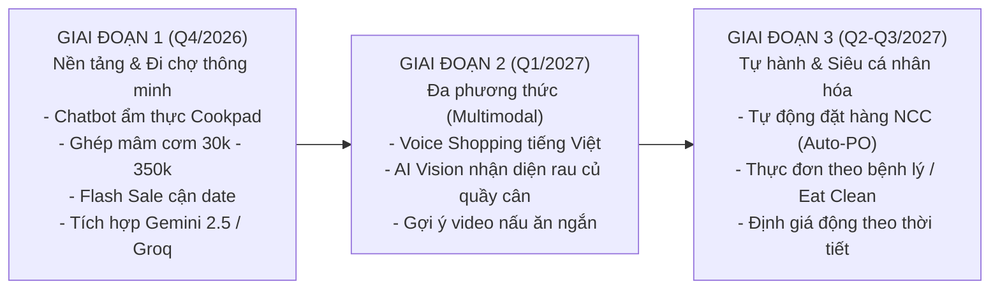

# 10_AI - TÀI LIỆU 09: LỘ TRÌNH PHÁT TRIỂN & NÂNG CẤP HỆ SINH THÁI AI (ROADMAP)

---

## MỤC LỤC
1. [Tổng quan lộ trình phát triển](#1-tổng-quan-lộ-trình-phát-triển)
2. [Giai đoạn 1: Nền tảng & Đi chợ hội thoại (Đã hoàn thành - Q4/2026)](#2-giai-đoạn-1-nền-tảng--đi-chợ-hội-thoại-q42026)
3. [Giai đoạn 2: Đa phương thức & Trợ lý giọng nói (Q1/2027)](#3-giai-đoạn-2-đa-phương-thức--trợ-lý-giọng-nói-q12027)
4. [Giai đoạn 3: Chuỗi cung ứng tự hành & Siêu cá nhân hóa (Q2 - Q3/2027)](#4-giai-đoạn-3-chuỗi-cung-ứng-tự-hành--siêu-cá-nhân-hóa-q2---q32027)
5. [Các chỉ số đánh giá hiệu quả (Key Performance Indicators - KPIs)](#5-các-chỉ-số-đánh-giá-hiệu-quả-kpis)

---

## 1. TỔNG QUAN LỘ TRÌNH PHÁT TRIỂN

Lộ trình phát triển hệ sinh thái AI trong **Smart SuperMarket** được xây dựng theo mô hình 3 giai đoạn chuyển đổi số: Từ việc hỗ trợ trải nghiệm mua sắm cơ bản (Conversational Commerce) hướng tới tự động hóa toàn diện chuỗi cung ứng siêu thị (Autonomous Supply Chain).

---

## 2. GIAI ĐOẠN 1: NỀN TẢNG & ĐI CHỢ HỘI THOẠI (ĐÃ HOÀN THÀNH - Q4/2026)

- **Mục tiêu**: Đặt nền móng kỹ thuật vững chắc và giải quyết bài toán tư vấn thực đơn hàng ngày.
- **Các tính năng đã triển khai thành công**:
  1. **Đầu bếp & Trợ lý đi chợ 3 phương án**: Tự động nhận diện ngân sách (từ 30k sinh viên đến tiệc gia đình) và gợi ý 3 mâm cơm chuẩn cẩm nang Cookpad Việt Nam.
  2. **Ghép danh mục cách ly (Category Isolation)**: Đảm bảo 100% khớp đúng thịt tươi từ Danh mục 9, rau củ từ Danh mục 4 và đồ ăn liền từ Danh mục 10.
  3. **Kiến trúc LLM Chained Fallback**: Hỗ trợ Google Gemini 2.5 Flash, Gemini 2.0 Flash, Groq Llama 3.3 và Local Cookpad Rule Engine hoạt động 24/7.
  4. **Dynamic Shelf-Life & Flash Sale**: Quét hạn dùng lô hàng theo thời gian thực và tự động áp dụng chiết khấu 30% cho hàng cận date.
  5. **1-Click nạp giỏ hàng & WinForms Copilot**: Tích hợp mượt mà giữa Web React và máy POS thu ngân WinForms.

---

## 3. GIAI ĐOẠN 2: ĐA PHƯƠNG THỨC & TRỢ LÝ GIỌNG NÓI (Q1/2027)

- **Mục tiêu**: Nâng cao tính tiện lợi và mở rộng phương thức tương tác tự nhiên cho khách hàng bận rộn.
- **Trọng tâm phát triển**:
  1. **Voice Shopping (Nhận diện giọng nói tiếng Việt)**: Khách hàng chỉ cần bấm mic và nói: *"Lên cho mình mâm cơm 4 người khoảng 100 nghìn"*, hệ thống tự động chuyển thành văn bản và xử lý ngay lập tức.
  2. **AI Computer Vision tại quầy cân tự động (Smart POS Scale)**:
     - Gắn camera nhận diện tại quầy cân rau củ.
     - Khách đặt bọc cà chua hoặc túi rau muống lên cân, camera AI tự động nhận diện đúng loại mặt hàng mà thu ngân không cần bấm mã tra cứu thủ công.
  3. **Short-form Cooking Video Guides**: Tích hợp link video hướng dẫn nấu ăn 30 giây kèm theo từng mâm cơm Cookpad.

---

## 4. GIAI ĐOẠN 3: CHUỖI CUNG ỨNG TỰ HÀNH & SIÊU CÁ NHÂN HÓA (Q2 - Q3/2027)

- **Mục tiêu**: Tối ưu hóa chi phí vận hành kho vận và tạo sự gắn kết trung thành tuyệt đối từ khách hàng.
- **Trọng tâm phát triển**:
  1. **Tự động hóa chuỗi cung ứng (Autonomous Reorder)**:
     - Khi tồn kho chạm ngưỡng an toàn và hệ thống dự báo nhu cầu tăng cao vào dịp lễ tết, AI tự động gửi đơn đặt hàng số (EDI / Webhook) trực tiếp tới các nhà cung cấp như C.P, Ba Huân, Vinamilk.
  2. **Dinh dưỡng cá nhân hóa theo chế độ ăn (Dietary & Health Profile)**:
     - Cho phép khách hàng cấu hình hồ sơ dinh dưỡng: *Ăn chay trường, Eat Clean, Giảm cân Keto, Bệnh tiểu đường, Dị ứng hải sản*.
     - AI chỉ gợi ý các nguyên liệu thỏa mãn chính xác các tiêu chí sức khỏe này.
  3. **Định giá động (Dynamic Pricing)**: Điều chỉnh tỷ lệ chiết khấu linh hoạt dựa trên dự báo thời tiết (ví dụ: ngày mưa gió tăng khuyến mãi các món lẩu nóng hổi).

---

## 5. CÁC CHỈ SỐ ĐÁNH GIÁ HIỆU QUẢ (KPIS)

| Chỉ số KPI | Mục tiêu hiện tại (Q4/2026) | Mục tiêu kỳ vọng (2027) |
| :--- | :---: | :---: |
| **Tỷ lệ chuyển đổi thành giỏ hàng (Chat-to-Cart Conversion)** | $\ge 35\%$ | $\ge 55\%$ |
| **Tỷ lệ giảm thiểu thất thoát thực phẩm hết hạn (Waste Reduction)**| Giảm $25\%$ | Giảm $60\%$ |
| **Giá trị đơn hàng trung bình (AOV Increase)** | Tăng $15\%$ nhờ gợi ý mâm | Tăng $30\%$ |
| **Thời gian phản hồi trung bình của Trợ lý AI** | $< 1.2\text{s}$ | $< 0.8\text{s}$ |
| **Điểm hài lòng của người dùng (Customer CSAT)** | $4.6 / 5.0$ | $4.9 / 5.0$ |
