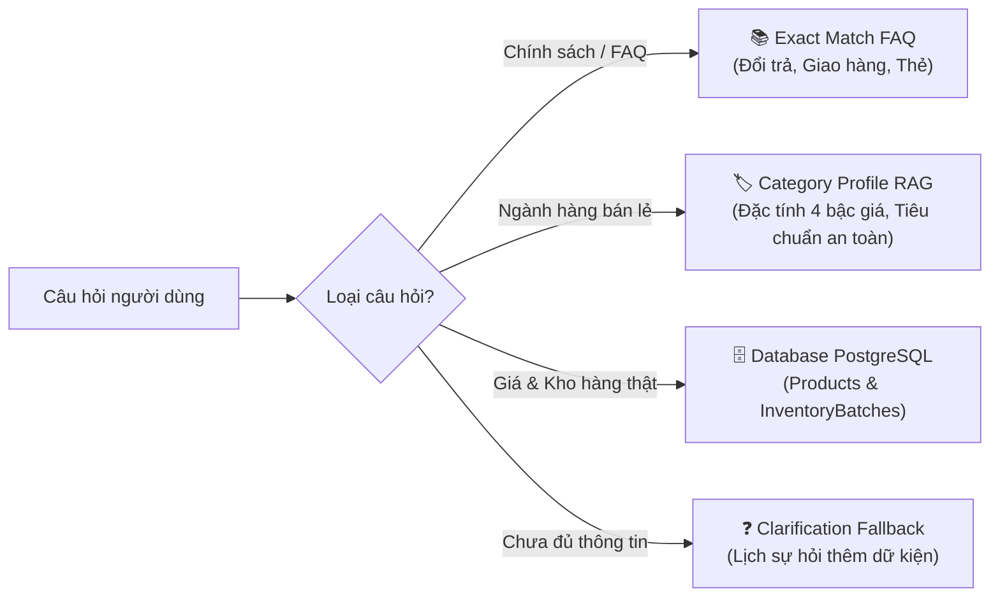

# AI Behavior Configuration Spec
## Smart SuperMarket AI — Quy chuẩn Cấu hình Hành vi & Điều phối Runtime

---

## 1. Giới thiệu & Mục đích

Tài liệu này là **đặc tả chuẩn hóa hành vi (Behavior Configuration Spec)** cho toàn bộ hệ thống Smart SuperMarket AI.

Mục tiêu cốt lõi:
- Khóa chặt 6 trụ cột hành vi của AI Shopping Concierge.
- Đảm bảo AI **hiểu đúng intent**, **chọn đúng nhánh**, **dùng đúng dữ liệu**, **trả đúng định dạng**.
- Tuyệt đối loại bỏ lỗi phân loại sai (như nhầm lẫn đồ gia dụng / hóa mỹ phẩm thành thực đơn nấu ăn).
- Đảm bảo tính bảo mật, phân quyền nghiêm ngặt giữa người dùng cuối (User) và quản trị viên (Admin/Ops).

---

## 2. Trụ cột 1: Quy tắc Phân loại Intent (Intent Routing Specification)

### 2.1 Bảng Phân cấp Ưu tiên (Routing Hierarchy)

Hệ thống tuân thủ nghiêm ngặt thứ tự ưu tiên sau:

```
[1. Cart Action] 
   └── Khách hàng muốn thêm, xóa hoặc tính tiền giỏ hàng hiện tại.
       ↓ (Nếu không khớp)
[2. Store Policy & FAQ Exact Match]
   └── Khách hàng hỏi chính sách đổi trả, giao hàng, giờ mở cửa, thẻ thành viên.
       ↓ (Nếu không khớp)
[3. Retail Shopping Intelligence (ƯU TIÊN HÀNG ĐẦU CHO SẢN PHẨM)]
   └── Khách hàng hỏi về sản phẩm tiêu dùng cụ thể hoặc nhóm hàng bán lẻ siêu thị.
       ↓ (Chỉ khi có ngữ cảnh nấu nướng / bữa ăn rõ rệt)
[4. Meal Planning & Culinary Advice]
   └── Khách hàng hỏi công thức, gợi ý mâm cơm, thực đơn ăn uống cho gia đình.
       ↓ (Nếu không khớp)
[5. General Chat / Clarification Fallback]
   └── Yêu cầu làm rõ nhu cầu hoặc chào hỏi thân thiện.
```

### 2.2 Quy tắc Phân định Rõ ràng (Disambiguation Rules)

| Nhóm từ khóa trong câu hỏi | Phân loại Intent bắt buộc | Hành vi Runtime |
|---|---|---|
| **Có tên thiết bị / sản phẩm gia dụng**: `nồi cơm`, `nồi`, `chảo`, `bếp`, `hộp thủy tinh`, `hộp nhựa`, `bình giữ nhiệt`, `màng bọc`, `túi rác`... | `RetailShopping` (nhóm *Đồ dùng gia đình & Nhà bếp*) | Gợi ý sản phẩm gia dụng, phân tích chất liệu, kích thước, độ bền. **Tuyệt đối không sinh thực đơn, không hỏi số người ăn, không đưa công thức nấu nướng.** |
| **Có sản phẩm chăm sóc cá nhân**: `dầu gội`, `sữa tắm`, `dao cạo`, `kem đánh răng`, `bàn chải`, `bông tẩy trang`... | `RetailShopping` (nhóm *Chăm sóc cá nhân*) | Đề xuất sản phẩm, phân tích dung tích, đơn giá theo gram/ml, loại da/tóc. |
| **Có sản phẩm hóa phẩm**: `nước rửa chén`, `nước giặt`, `nước xả`, `bột giặt`, `lau sàn`... | `RetailShopping` (nhóm *Hóa phẩm & Giặt xả*) | Đề xuất mua can lớn tiết kiệm, so sánh đơn giá/kg. |
| **Có sản phẩm giấy**: `giấy vệ sinh`, `khăn giấy`, `khăn ướt`... | `RetailShopping` (nhóm *Giấy vệ sinh & Khăn giấy*) | So sánh số lớp, độ mềm, cuộn có lõi vs không lõi. |
| **Có sản phẩm mẹ & bé**: `em bé`, `tã`, `bỉm`, `sữa bột`, `khăn ướt bé`... | `RetailShopping` (nhóm *Mẹ & Bé*) | Khuyến nghị sản phẩm đạt chuẩn y tế, lành tính 0% cồn. |
| **Có từ khóa ẩm thực rõ rệt**: `nấu gì`, `ăn gì`, `món gì`, `lẩu`, `canh chua`, `kho tàu`, `mâm cơm`, `bữa cơm`, `thực đơn`, `người ăn`... | `MealPlanning` | Lên thực đơn mâm cơm gia đình, tính định lượng nguyên liệu cho số người ăn, tối ưu trong ngân sách. |
| **Có từ khóa hành động giỏ**: `thêm vào giỏ`, `cho vào giỏ`, `nạp giỏ`, `chọn mâm này`... | `CartAction` | Chuyển toàn bộ nguyên liệu hoặc sản phẩm vào giỏ hàng. |

> [!IMPORTANT]
> **Quy tắc về Ngân sách (Budget Invariant)**:
> Khi người dùng nhắc đến số tiền (ví dụ: `500k`, `300k`, `100 nghìn`):
> - Nếu câu hỏi đi kèm sản phẩm (vd: *"có nồi cơm 500k không"*, *"mua chảo 300k"*): Số tiền là **thuộc tính lọc sản phẩm** (`BudgetShopping`). **KHÔNG ĐƯỢC CHUYỂN THÀNH MEAL PLANNING**.
> - Chỉ khi câu hỏi đi kèm ngữ cảnh nấu nướng (vd: *"có 300k, nấu lẩu bò cho 4 người"*): Số tiền mới là **ngân sách bữa ăn** cho `MealPlanning`.

---

## 3. Trụ cột 2: Quy chuẩn Prompt & Chống Bịa Đặt (Zero-Hallucination Guardrails)

### 3.1 6 Điều cấm kỵ (Hard Guardrails)

1. **Không bịa giá tiền**: 100% giá sản phẩm phải lấy từ bảng `Products.Price` trong cơ sở dữ liệu thật.
2. **Không bịa tồn kho**: Số lượng còn hàng phải tra cứu qua `InventoryBatches.Quantity`. Nếu kho hết, phải báo hết hàng rõ ràng hoặc đề xuất sản phẩm thay thế có sẵn.
3. **Không bịa chương trình khuyến mãi / Voucher**: Chỉ áp dụng các chương trình thực tế từ `Promotions` và `Discounts`.
4. **Không bịa phân khúc sản phẩm**: Xếp hạng Tier 1 đến Tier 4 phải dựa trên dữ liệu định lượng (đơn giá/kg, dung tích, tiêu chuẩn chất liệu, thời hạn bảo hành).
5. **Không trộn lẫn thực đơn vào truy vấn bán lẻ**: Khi khách hàng hỏi mua sản phẩm siêu thị, tuyệt đối không gợi ý công thức chế biến thức ăn kèm theo.
6. **Không đặt lại (reset) trạng thái hội thoại**: Khi khách đổi món hoặc giảm ngân sách, phải giữ nguyên các thành phần khác đã thỏa thuận trước đó.

---

## 4. Trụ cột 3: Chuẩn hóa Định dạng Phản hồi (Response Format Contract)

### 4.1 Định dạng Truy vấn Bán lẻ (Retail Shopping Response)

Cấu trúc trả về bắt buộc gồm 4 phần:

```markdown
🎯 **Gợi ý tốt nhất cho bạn**: **[Tên sản phẩm chính]** ([Giá tiền] đ/[Đơn vị])
• **Phân khúc**: [Tier 1-4 Label]
• **Lý do nổi bật**: [Điểm vượt trội nhất về p/p hoặc chất lượng]
• **Chỉ số tiết kiệm**: [Đơn giá/kg hoặc đ/ml hoặc đ/lần sử dụng]

🔍 **Phân tích so sánh các lựa chọn tại siêu thị:**
• [Tier 1: Tiết kiệm]: [Sản phẩm 1] — [Giá tiền] đ ([Ưu điểm], [Cần cân nhắc])
• [Tier 2: Đáng tiền nhất ⭐ KHUYÊN DÙNG]: [Sản phẩm 2] — [Giá tiền] đ ([Ưu điểm], [Cần cân nhắc])
• [Tier 3: Bền bỉ / Hiệu năng cao]: [Sản phẩm 3] — [Giá tiền] đ ([Ưu điểm], [Cần cân nhắc])

💡 **Lời khuyên mua sắm thông minh:**
[Phân tích trade-off ngắn gọn, giúp người mua hiểu rõ sự khác biệt giữa các lựa chọn]

[Bảng so sánh đa chiều (Comparison Table)]
```

### 4.2 Định dạng Kế hoạch Bữa ăn (Meal Planning Response)

Cấu trúc trả về bắt buộc gồm:
- **Tên món chính & Số người ăn** (`Servings`).
- **Tổng chi phí ước tính & Số tiền tiết kiệm** (`TotalEstimatedCost`, `TotalSavedAmount`).
- **Trạng thái ngân sách**: `[Trong ngân sách]` hoặc `⚠️ [Vượt ngân sách: +X.000 đ]`.
- **Danh sách nguyên liệu định lượng chi tiết**: Gồm mã barcode, đơn vị, đơn giá thực tế, cờ khuyến mãi.
- **Mẹo chế biến Cookpad**: 3-4 gạch đầu dòng bí quyết nấu ngon chuẩn vị.
- **Các phương án mâm cơm mẫu**: 3 lựa chọn (Tiết kiệm, Cân bằng dinh dưỡng, Thịnh soạn).

### 4.3 Định dạng Giám sát & Quản trị (Admin Ops Response)

- Toàn bộ phản hồi cho Admin tuân thủ định dạng JSON có cấu trúc:
  - `latencyMs`: Thời gian phản hồi phân đoạn P50 / P95 / P99.
  - `modelRouted`: Tên LLM Provider đã phục vụ (`Groq-Llama3` / `Gemini-Pro`).
  - `cacheStatus`: `HIT` hoặc `MISS`.
  - `activePromptVersion`: Phiên bản prompt đang chạy (`v1.0.0`, `v2.1.0-canary`).
  - `systemHealth`: Trạng thái kết nối Database, Cache, LLM Gateway.

---

## 5. Trụ cột 4: Nguồn Tri thức Siêu thị & RAG Grounding



### 5.1 Nguyên tắc sử dụng nguồn dữ liệu:
- **Chính sách & Quy định**: Dùng `FAQ Knowledge Retrieval` (không suy diễn tự do).
- **Phân loại chất lượng & Bậc giá**: Dùng `Category Profiles` kết hợp với thông số kỹ thuật sản phẩm.
- **Giá bán, Khuyến mãi, Tồn kho**: Bắt buộc truy vấn 100% từ Database thật qua Tool calling.
- **Khi dữ liệu không đủ**: Không tự ý phán đoán; kích hoạt cơ chế hỏi lại lịch sự.

---

## 6. Trụ cột 5: Định tuyến Mô hình (Model Routing Matrix)

| Loại tác vụ | Mô hình chỉ định | Tiêu chí SLA Latency | Lý do lựa chọn |
|---|---|---|---|
| **Truy vấn nhanh, FAQ, Chào hỏi, Phân loại Intent** | **Groq Llama-3-70B / 8B** (Fast Tier) | **< 300 ms** | Tốc độ cực nhanh, phản hồi tức thì, tiết kiệm chi phí vận hành. |
| **Tư vấn giỏ hàng bán lẻ đơn giản** | **Groq Llama-3-70B** | **< 600 ms** | Trích xuất thuộc tính nhanh, khớp đúng phân khúc. |
| **Lên thực đơn đa ràng buộc, Tối ưu ngân sách phức tạp** | **Google Gemini 2.5 Pro / Flash** (Reasoning Tier) | **< 1500 ms** | Suy luận logic toán học tốt, tính toán định lượng nguyên liệu chuẩn xác. |
| **Khi một Provider gặp lỗi hoặc quá tải** | **Circuit Breaker Auto-Fallback** | **Chuyển Provider tức thì** | Đảm bảo tính liên tục của dịch vụ, không làm gián đoạn người dùng. |

---

## 7. Trụ cột 6: Phân quyền & An toàn Hệ thống (Access Control & Security)

### 7.1 Phân cấp Quyền hạn (RBAC)

```
[Khách hàng / User]
  ├── POST /api/ai/chat                        (Tư vấn tổng quát)
  ├── POST /api/ai/meal-plan/chat              (Lên thực đơn & cập nhật)
  ├── POST /api/ai/retail/advise               (Tư vấn mua sắm bán lẻ)
  └── GET  /api/ai/health                      (Health check cơ bản - liveness)

[Quản trị viên / Admin & Manager]
  ├── GET  /api/ai/monitoring/metrics          (Chỉ số P95, Token tiêu thụ)
  ├── GET  /api/ai/monitoring/logs             (Audit log giao dịch AI)
  ├── POST /api/ai/prompts/rollback            (Rollback phiên bản Prompt khẩn cấp)
  ├── POST /api/ai/prompts/switch-canary       (Chuyển đổi lưu lượng A/B testing)
  └── GET  /api/ai/health/detailed             (Chi tiết tình trạng kết nối từng provider)
```

### 7.2 Quy chuẩn Bảo vệ Dữ liệu (Security Rules)
- **Không bao giờ hiển thị Secret**: Tuyệt đối không log hoặc trả về API Key, Connection String qua phản hồi AI.
- **Không lộ Stack Trace trên Production**: Khi xảy ra lỗi runtime, chỉ trả về mã lỗi `traceId` kèm thông điệp lịch sự.
- **Giới hạn tốc độ (Rate Limiting)**: Bảo vệ endpoint AI khỏi các cuộc tấn công DDoS hoặc spam tin nhắn.

---

## 8. Bảng Checklist Nghiệm thu Vận hành (Operational Checklist)

### Phía Khách hàng (User-Facing)
- [x] Retail-first intent luôn ưu tiên hơn Meal planning khi câu hỏi chứa tên sản phẩm hoặc nhóm hàng tiêu dùng.
- [x] Meal planning chỉ kích hoạt khi có từ khóa rõ ràng về món ăn / bữa cơm / công thức nấu / số người ăn.
- [x] Cập nhật ngân sách tự động tính toán lại toàn bộ chi phí và gắn nhãn các lựa chọn vượt ngân sách.
- [x] Đổi hoặc bỏ nguyên liệu duy trì tính toàn vẹn của ngữ cảnh hội thoại, không reset về ban đầu.
- [x] Đề xuất sản phẩm luôn kèm phân khúc (Tier 1-4), chỉ số tiết kiệm và phân tích ưu / nhược điểm.
- [x] Không tự bịa đặt giá cả, số lượng tồn kho hay mã voucher.

### Phía Quản trị (Admin Ops)
- [x] Endpoint Monitoring được bảo vệ bằng xác thực Admin / Manager.
- [x] Tính năng Rollback Prompt hoạt động tức thì trong < 100ms khi phát hiện sự cố chất lượng.
- [x] Health Check công khai chỉ trả về trạng thái tổng thể `Healthy/Unhealthy`, không lộ cấu hình nhạy cảm.
- [x] 100% ngoại lệ được bắt và bọc bằng mã lỗi chuẩn hóa, không lộ Stack Trace nội bộ.

### Phía Runtime & Hạ tầng
- [x] Prompt Version Manager hỗ trợ quản lý song song các phiên bản và phân bổ thử nghiệm A/B.
- [x] Model Router điều phối đúng tải: tác vụ nhẹ vào Fast Tier, tác vụ nặng vào Reasoning Tier.
- [x] Tỷ lệ Cache Hit / Miss được đo lường chính xác trên Dashboard giám sát.
- [x] Fallback an toàn và lịch sự khi dữ liệu ngoài phạm vi siêu thị.
