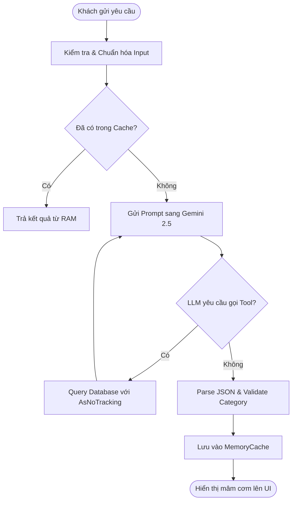

# TEMPLATE: THIẾT KẾ LUỒNG XỬ LÝ AI END-TO-END (WORKFLOW SPECIFICATION TEMPLATE)

---

## 1. TỔNG QUAN LUỒNG (WORKFLOW OVERVIEW)

- **Tên luồng**: `[Ví dụ: Luồng Tự Động Phân Bổ Mâm Cơm Thông Minh Theo Ngân Sách]`
- **Mã luồng**: `[WF-MEAL-PLAN-01]`
- **Tác nhân kích hoạt (Trigger)**: `Người dùng gửi tin nhắn hoặc bấm nút gợi ý mâm cơm trên giao diện`
- **Mục tiêu hoàn thành**: `Trả về 3 mâm cơm Cookpad hợp lệ kèm giá niêm yết và trạng thái tồn kho`

---

## 2. MERMAID DIAGRAM (SƠ ĐỒ TRÌNH TỰ / LUỒNG)

---

## 3. CÁC BƯỚC THỰC THI CHI TIẾT

### Bước 1: Tiếp nhận và Chuẩn hóa tham số (Input Normalization)
- Trích xuất số lượng người ăn (mặc định 1 nếu không chỉ định).
- Trích xuất ngân sách tối đa (VND).
- Chuẩn hóa danh sách nguyên liệu dị ứng / loại trừ.

### Bước 2: Truy xuất Dữ liệu & Gọi Tools
- Lấy danh mục sản phẩm tươi sống đang có sẵn trong kho (`StockQuantity > 0`).
- Kiểm tra danh sách sản phẩm cận date để ưu tiên gắn vào mâm cơm Flash Sale.

### Bước 3: Phân tích & Suy luận (Inference)
- Sử dụng mô hình `gemini-2.5-flash` với system prompt nghiêm ngặt.
- Tuân thủ quy tắc cô lập danh mục:
  - Danh mục 9: Thịt, Trứng, Hải sản tươi sống.
  - Danh mục 4: Rau củ quả tươi.
  - Danh mục 10: Thực phẩm ăn liền, đồ hộp.
  - Danh mục 5: Gia vị, phụ liệu.

### Bước 4: Hậu kiểm & Fallback
- Kiểm tra tính toán ngân sách: tổng tiền các món trong mâm phải $\le$ ngân sách yêu cầu (+- 10%).
- Nếu xảy ra lỗi hoặc thời gian phản hồi vượt quá 4 giây: Kích hoạt ngay Fallback Rule Engine cục bộ.

---

## 4. TIÊU CHÍ NGHIỆM THU (ACCEPTANCE CRITERIA)
- [ ] Thời gian phản hồi trung bình $\le$ 2.5 giây.
- [ ] 100% nguyên liệu gợi ý có ID sản phẩm tồn tại trong cơ sở dữ liệu.
- [ ] Không có sản phẩm nào bị phân loại sai danh mục (VD: Không để mì gói vào danh mục thịt tươi).
- [ ] Giao diện thẻ mâm cơm hiển thị căn trái (`text-align: left`) rõ ràng và tương thích trên mobile.
