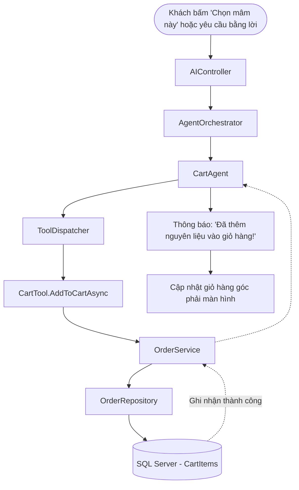

# WORKFLOW: QUY TRÌNH THAO TÁC GIỎ HÀNG (CART INJECTION WORKFLOW)

---

## Các Bước Thực Thi Chi Tiết
1. **Trích xuất nguyên liệu**: Nhận danh sách các `ProductId` và `Quantity` từ thẻ mâm cơm được khách chọn.
2. **Kiểm tra kho lần cuối**: Đảm bảo toàn bộ các món trong mâm vẫn còn đủ hàng trong kho ngay tại thời điểm bấm nút.
3. **Nạp vào giỏ**: Ghi các bản ghi vào bảng `CartItems` gắn liền với `SessionId` của khách hàng.
4. **Phản hồi**: Hiển thị badge số lượng sản phẩm trên icon Giỏ hàng và mở slide-over kiểm tra.
