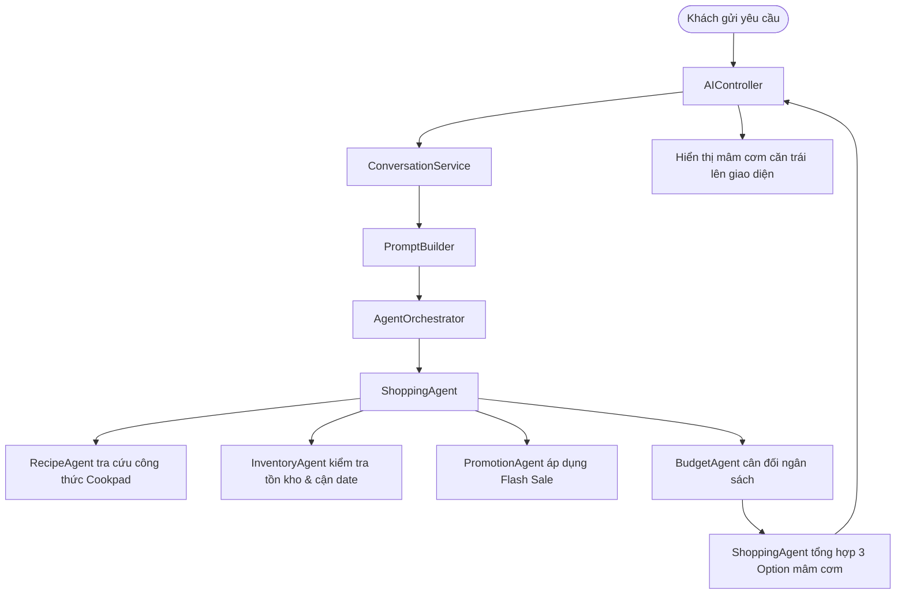

# WORKFLOW: QUY TRÌNH TƯ VẤN MÂM CƠM (MEAL PLANNING WORKFLOW)

---

## Các Bước Thực Thi Chi Tiết
1. **Tiếp nhận yêu cầu**: Lọc số người ăn, ngân sách dự kiến và từ khóa món ăn.
2. **Khớp nguyên liệu**: Gọi `RecipeTool` để lấy danh sách nguyên liệu và định lượng theo `servings`.
3. **Kiểm tra tồn kho**: Gọi `InventoryTool` để đối chiếu tồn kho thực tế, nếu hết hàng tự động đổi sang món thay thế tương đương.
4. **Ưu tiên Flash Sale**: Tự động ghép các lô hàng $\le 3$ ngày giảm 30% để giảm chi phí bữa ăn.
5. **Cân đối chi phí**: Nếu tổng tiền $> \text{Budget}$, kích hoạt `BudgetAgent` hạ bớt món đắt tiền để bảo toàn ngân sách.
